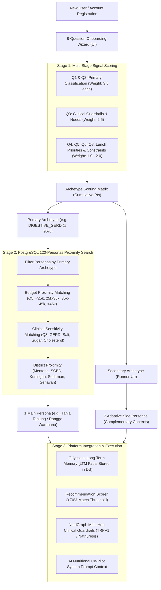

# NutriSea Persona Determination Engine & Onboarding Specification

> **Grounded in Authentic Indonesian Urban Gastronomy Dataset & Clinical Consensus**  
> **Source Specification**: `backend/docs/persona_onboarding_questions.txt`  
> **API Implementation**: `backend/app/api/personas.py` (`POST /api/personas/match`)  
> **Frontend Implementation**: `frontend/src/app/onboarding/personas/page.tsx`  

---

## 1. Executive Summary & Purpose

The **NutriSea Persona Determination Engine** translates raw user inputs from an 8-question onboarding questionnaire into a precise biological and lifestyle profile. Rather than treating onboarding as a rigid diagnosis or an arbitrary quiz, the engine operates as a **Multi-Stage Signal Inference System**:

1. **Infers Primary & Secondary Behavioral Archetypes** across 4 core worker classifications:
   - `CORP_OVERLOADED`: *The Overloaded Corporate Professional*
   - `PREVENTIVE_HEALTH`: *The Preventive Health Starter*
   - `BUDGET_FITNESS`: *The Budget-Conscious Fitness Enthusiast*
   - `DIGESTIVE_GERD`: *The Digestive & Gentle Palate Fighter*
2. **Performs Precision Proximity Matching** against the **120 Indonesian Urban Worker Personas** stored in the Aiven Cloud PostgreSQL database.
3. **Assigns 1 Main Persona** (primary driver for caloric target, meal budget, and clinical guardrails) and **3 Adaptive Side Personas** (for context switching: late-night overtime, weekend workouts, gastric flare recovery).
4. **Bootstraps Odysseus Long-Term Memory (LTM)** and activates **NutriGraph Knowledge Graph Clinical Guardrails** without latency.

---

## 2. End-to-End Architectural Flow



---

## 3. The 8 Onboarding Questions Taxonomy

The questionnaire is adapted directly from `persona_onboarding_questions.txt` with authentic Indonesian phrasing and English subtitles:

### **Q1. Apa tujuan utama Anda saat memilih makanan?**
*What is your main goal when choosing food?* (Single Choice)
- `Keep my energy steady and choose a balanced meal.` ➔ `+3.5 CORP_OVERLOADED`
- `Eat healthier and reduce my risk of future health problems.` ➔ `+3.5 PREVENTIVE_HEALTH`
- `Build muscle or support my fitness progress.` ➔ `+3.5 BUDGET_FITNESS`
- `Choose food that is gentle on my stomach.` ➔ `+3.5 DIGESTIVE_GERD`
- `I'm not sure yet.` ➔ Neutral default

### **Q2. Mana yang paling menggambarkan kekhawatiran makan Anda saat ini?**
*Which best describes your current food-related concern?* (Single Choice)
- `I often feel sleepy, sluggish, or too full after lunch.` ➔ `+3.5 CORP_OVERLOADED`
- `I want to be more careful about things like salt, sugar, or fat.` ➔ `+3.5 PREVENTIVE_HEALTH`
- `I want enough protein without spending too much.` ➔ `+3.5 BUDGET_FITNESS`
- `Some foods can trigger stomach discomfort, acidity, or heartburn.` ➔ `+3.5 DIGESTIVE_GERD`
- `None of these.` ➔ Neutral default

### **Q3. Apakah Anda memiliki kebutuhan diet atau pantangan makanan?**
*Do you have any dietary needs or restrictions we should consider?* (Single Choice + Conditional Follow-Up)
- `I need to limit salt.` ➔ `+2.5 PREVENTIVE_HEALTH` (Enforces sodium ceiling limit)
- `I need to be mindful of sugar or blood glucose.` ➔ `+2.5 PREVENTIVE_HEALTH` (Enforces glycemic guardrail)
- `I need to be mindful of cholesterol or saturated fat.` ➔ `+2.5 PREVENTIVE_HEALTH` (Blocks deep fry / santan kental)
- `I need food that is gentle on my stomach.` ➔ `+2.5 DIGESTIVE_GERD` (Enforces anti-TRPV1 / non-acidic)
- `I have a food allergy or intolerance.` ➔ Sets Hard Allergen Filter (Peanuts, Seafood, Egg, Dairy)
- `I don't have any specific dietary restrictions.` ➔ Standard PGRS baseline
- `Prefer not to say.`
*Conditional Follow-up*:  
*Is this based on guidance from a healthcare professional, or is it a personal preference?*
- `Guidance from a healthcare professional` ➔ Elevates rule confidence to **1.00 (Critical Hard Guardrail)**
- `Personal preference` ➔ Elevates rule confidence to **0.90 (High Priority Filter)**
- `Prefer not to say`

### **Q4. Apa pertimbangan paling penting saat memilih makan siang?**
*What matters most when choosing your lunch?* (Single Choice)
- `I want a quick recommendation so I don't have to browse many options.` ➔ `+2.0 CORP_OVERLOADED`
- `I want a meal that supports my long-term health.` ➔ `+2.0 PREVENTIVE_HEALTH`
- `I want good nutrition and enough protein at an affordable price.` ➔ `+2.0 BUDGET_FITNESS`
- `I want to avoid ingredients or preparation styles that may upset my stomach.` ➔ `+2.0 DIGESTIVE_GERD`
- `I mainly want to choose based on taste.` ➔ Neutral

### **Q5. Berapa perkiraan anggaran makan siang Anda per porsi?**
*What is your usual budget for one lunch?* (Single Choice)
- `Under Rp25,000` ➔ `+1.5 BUDGET_FITNESS` (Calibrates budget target to ~Rp 22.000–25.000)
- `Rp25,000–Rp35,000` ➔ Standard Urban Tier (Calibrates budget target to ~Rp 30.000–35.000)
- `Rp35,001–Rp45,000` ➔ Mid-Tier Urban (Calibrates budget target to ~Rp 40.000)
- `More than Rp45,000` ➔ `+1.0 CORP_OVERLOADED` (Calibrates budget target to ~Rp 50.000–60.000)
- `It depends on the day` ➔ Defaults to Rp 35.000

### **Q6. Seberapa aktif rutinitas harian Anda?**
*How active is your usual day?* (Single Choice)
- `Mostly sitting; little planned exercise` ➔ `+1.0 CORP_OVERLOADED` (Light activity multiplier 1.3)
- `Light activity or occasional exercise` ➔ Standard multiplier 1.4
- `Moderate activity or regular exercise` ➔ `+1.5 BUDGET_FITNESS` (Moderate multiplier 1.55)
- `Very active or frequent intense exercise` ➔ `+2.0 BUDGET_FITNESS` (Heavy multiplier 1.75)
- `Not sure` ➔ Default 1.375

### **Q7. Rentang usia Anda? (Opsional)**
*Which age range are you in?* (Single Choice)
- `Under 21` | `21–27` | `28–33` | `34–48` | `49 or older` | `Prefer not to say`

### **Q8. Apa yang biasanya membuat memilih makan siang terasa sulit?**
*What usually makes choosing lunch difficult for you?* (Single Choice)
- `Too many options; I spend too much time deciding.` ➔ `+2.0 CORP_OVERLOADED` (Decision fatigue)
- `I'm unsure whether a meal is balanced or healthy.` ➔ `+2.0 PREVENTIVE_HEALTH`
- `Healthy food often costs more than I want to spend.` ➔ `+2.0 BUDGET_FITNESS`
- `I'm worried a meal may trigger stomach discomfort.` ➔ `+2.0 DIGESTIVE_GERD`
- `I find it difficult to estimate nutrition information.` ➔ Triggers auto macro breakdown
- `None of these.` ➔ Neutral

---

## 4. Signal Scoring & Archetype Selection Matrix

The matching algorithm computes the cumulative score $S_a$ for each archetype $a \in \{\text{CORP\_OVERLOADED}, \text{PREVENTIVE\_HEALTH}, \text{BUDGET\_FITNESS}, \text{DIGESTIVE\_GERD}\}$:

$$S_a = w_1 \cdot Q_1(a) + w_2 \cdot Q_2(a) + w_3 \cdot Q_3(a) + w_4 \cdot Q_4(a) + w_5 \cdot Q_5(a) + w_6 \cdot Q_6(a) + w_8 \cdot Q_8(a)$$

Where:
- $w_1 = w_2 = 3.5$ (Primary classification weights)
- $w_3 = 2.5$ (Dietary safeguards weight)
- $w_4 = w_8 = 2.0$ (Priorities & friction weights)
- $w_5 = w_6 = 1.5$ (Demographic & budget context weights)

### **Confidence Percentage Formula**
$$\text{Confidence} = \min\left(99\%, \max\left(75\%, \left\lfloor \frac{S_{\text{primary}}}{S_{\text{max\_possible}}} \times 100 \right\rfloor \right)\right)$$
*(Baseline ceiling: 14.5 points; typical scores range between 88% and 98% match).*

---

## 5. PostgreSQL Proximity Function for Persona Assignment

Once the Primary Archetype is established, the engine queries the PostgreSQL `persona` table to choose the single best personified representation:

```python
def candidate_score(p: Persona) -> float:
    score = 100.0
    # 1. Budget Deviation Penalty
    budget_diff = abs(p.target_lunch_budget_idr - target_budget)
    score -= min(30.0, (budget_diff / target_budget) * 30.0)

    # 2. Medical Condition Synergy Bonus
    conds = (p.medical_conditions or "").upper()
    if "salt" in q3 and any(k in conds for k in ["HYPERTENSION", "HIPERTENSI"]):
        score += 20.0
    if "stomach" in q3 and any(k in conds for k in ["GERD", "GASTRITIS", "MAAG"]):
        score += 25.0
    if "sugar" in q3 and any(k in conds for k in ["DIABETES", "PREDIABETES", "GLUKOSA"]):
        score += 20.0
    if "cholesterol" in q3 and any(k in conds for k in ["CHOLESTEROL", "DISLIPIDEMIA", "KOLESTEROL"]):
        score += 20.0

    return score
```

The highest-scoring individual becomes the user's **Main Persona** (e.g. `DIGE_TANIA_KUNINGAN_086` or `CORP_YOGA_MENTENG_004`).

### **Selection of 3 Adaptive Side Personas**
To reflect dynamic lifestyle changes, the engine auto-assigns 3 complementary personas:
1. **Secondary Persona**: Selected from the runner-up archetype.
2. **Fitness/Active Persona**: Selected from `BUDGET_FITNESS` (activated during weekend exercise or high-protein recovery).
3. **Restorative Persona**: Selected from `DIGESTIVE_GERD` or `PREVENTIVE_HEALTH` (activated when user reports stomach upset or seeks clean detox).

---

## 6. Downstream Platform Effects

Upon confirming the diagnosis result:

| Platform Component | Immediate Effect |
| :--- | :--- |
| **PostgreSQL Database** | Upserts `app_user` with `main_persona_id` and `side_persona_ids`. Synchronizes Mifflin-St Jeor values into `health_profile`. |
| **Odysseus Long-Term Memory (LTM)** | Automatically writes persistent facts to `user_memory_item` (e.g. `Target kalori makan siang: 650 kcal`, `Pagu budget Rp 35.000`, `Batasi natrium & capsaicin`). |
| **Recommendation Scorer** | Filters home feed catalog to menu items scoring **> 70%** clinical fit, capped at the **Top 10** items. |
| **NutriGraph Guardrails** | Automatically evaluates multi-hop graph paths on dish detail pages (`/menu/[id]`), flagging violations with physiological mechanism explanations (TRPV1 receptor stimulation, sodium natriuresis). |
| **AI Nutritional Co-Pilot** | Injects user archetype identity, short-term clicks, and clinical guardrails into the LLM system prompt. |

---

## 7. API Reference

### `POST /api/personas/match`
**Request Body**:
```json
{
  "q1_goal": "Choose food that is gentle on my stomach.",
  "q2_concern": "Some foods can trigger stomach discomfort, acidity, or heartburn.",
  "q3_dietary_needs": "I need food that is gentle on my stomach.",
  "q3_follow_up": "Guidance from a healthcare professional",
  "q4_lunch_priority": "I want to avoid ingredients or preparation styles that may upset my stomach.",
  "q5_budget": "Rp25,000–Rp35,000",
  "q6_activity": "Light activity or occasional exercise",
  "q7_age_range": "21–27",
  "q8_difficulty": "I'm worried a meal may trigger stomach discomfort."
}
```

**Response Body**:
```json
{
  "primary_archetype": {
    "code": "DIGESTIVE_GERD",
    "name": "The Digestive & Gentle Palate Fighter",
    "score": 12.5,
    "confidence_percent": 96
  },
  "secondary_archetype": {
    "code": "CORP_OVERLOADED",
    "name": "The Overloaded Corporate Professional",
    "score": 1.0
  },
  "main_persona": {
    "id": "DIGE_TANIA_KUNINGAN_086",
    "full_name": "Tania Tanjung",
    "archetype_code": "DIGESTIVE_GERD",
    "archetype_name": "The Digestive & Gentle Palate Fighter",
    "target_lunch_kcal": 550,
    "target_lunch_budget_idr": 35000,
    "medical_conditions": "GERD, GASTRITIS"
  },
  "side_personas": [
    { "id": "CORP_ALVIN_SENAYAN_042", "full_name": "Alvin Senayan", "archetype_name": "The Overloaded Corporate Professional" },
    { "id": "BUDG_FACHRI_MENTENG_115", "full_name": "Fachri Lestari", "archetype_name": "The Budget-Conscious Fitness Enthusiast" },
    { "id": "PREV_AGNES_MENTENG_003", "full_name": "Agnes Wulandari", "archetype_name": "The Preventive Health Starter" }
  ],
  "rationale": "Fokus pada hidangan ramah lambung, bebas asam/pedas ekstrem (capsaicin), dan metode masak yang lembut untuk mencegah asam lambung naik.",
  "dietary_safeguards": {
    "selected_restriction": "I need food that is gentle on my stomach.",
    "is_medical_guidance": true
  }
}
```
