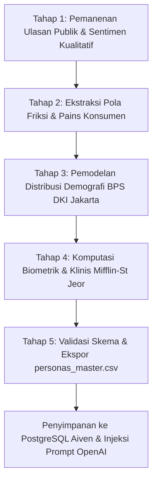
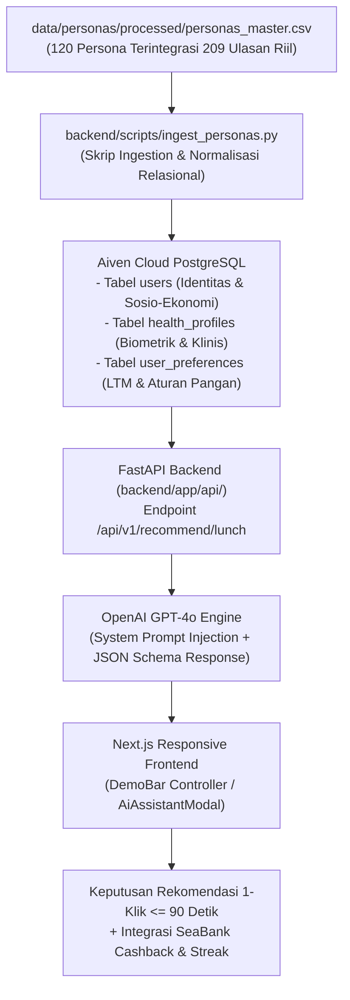

# Dokumentasi Metodologi Pengumpulan Data dan Kamus Data Persona Konsumen NutriSea

Proyek: NutriSea - Autonomous Nutritional Co-Pilot
Inisiatif: Sea x OpenAI Regional Codex Hackathon
Dokumen: Spesifikasi Arsitektur Data, Metodologi Scraping/Sintesis, dan Kamus Data Persona

---

## 1. Pendahuluan, Target Nyata, dan Tujuan Strategis Proyek

Dokumen ini menyajikan metodologi ilmiah, alur pengumpulan data, serta kamus data komprehensif bagi dataset persona konsumen (*Consumer Persona Dataset*) yang dikembangkan untuk sistem NutriSea. NutriSea adalah agen cerdas (*autonomous nutritional co-pilot*) yang terintegrasi pada ekosistem ShopeeFood dan SeaBank.

Berbeda dari persona demografis konvensional yang bersifat deskriptif statis atau asumsi hipotetis belaka, dataset ini dirancang sebagai data acuan operasional (*operational ground truth*) yang dapat dioperasikan secara komputasional oleh model bahasa besar (Large Language Model, seperti OpenAI GPT-4o) dan disimpan secara relasional pada basis data PostgreSQL Aiven. Dataset ini menyatukan parameter biometrik klinis, batasan anggaran finansial, motivasi berbasis tugas (*Jobs-To-Be-Done*), dan friksi psikologis harian ke dalam 33 atribut terstruktur.

### 1.1. Target Realistis dan Terukur Proyek (Measurable Key Performance Indicators)
Pembangunan dataset persona ini secara langsung diarahkan untuk mencapai empat target performa konkret (*KPI*) pada aplikasi NutriSea:

1. **Pemangkasan Waktu Keputusan Makan Siang (Decision Latency Reduction)**:
   * *Baseline Nyata*: Berdasarkan analisis ulasan empiris pekerja kantor di kawasan bisnis Jakarta, pengguna menghabiskan rata-rata 15 hingga 25 menit (rata-rata 20.0 menit) setiap hari kerja hanya untuk menelusuri katalog menu (*scrolling*) dan membandingkan harga.
   * *Target NutriSea*: Memangkas waktu pengambilan keputusan menjadi maksimal 90 detik (efisiensi waktu sebesar 92.5%) melalui rekomendasi hidangan tunggal terbaik yang relevan secara gizi, selera, dan anggaran hanya dengan satu klik konfirmasi.

2. **Kepatuhan Pembatasan Kalori dan Natrium Klinis (Clinical Guardrail Compliance)**:
   * *Baseline Masalah*: Konsumsi makan siang pekerja kantor di Jakarta umumnya didominasi karbohidrat sederhana berlebih (nasi porsi besar ditambah gorengan/tepung) dengan estimasi >850 kcal dan natrium >1.200 mg, yang memicu lonjakan glukosa drastis dan rasa kantuk berat (*food coma*) pada jam 14:00 serta memperparah keluhan lambung (GERD).
   * *Target NutriSea*: Memastikan 100% rekomendasi menu makan siang berada tepat pada batas alokasi kalori makan siang 30-35% TDEE (rentang 500 - 750 kcal) dan batas natrium maksimal 700 mg per sajian makan siang, mempertahankan fokus kerja sepanjang sore tanpa penurunan produktivitas.

3. **Keterjangkauan Harga Pangan Sehat Harian (Price Affordability Index)**:
   * *Baseline Masalah*: Makanan sehat komersial (seperti katering diet perkantoran atau salad impor) memiliki harga rata-rata Rp 75.000 hingga Rp 120.000 per porsi, yang menjadikannya tidak realistis dijadikan rutinitas makan siang harian oleh mayoritas pekerja dengan pendapatan Rp 6.000.000 - Rp 18.000.000/bulan.
   * *Target NutriSea*: Membatasi rekomendasi pada rentang anggaran riil harian pekerja, yaitu Rp 25.000 hingga Rp 45.000 per porsi (rata-rata target persona: Rp 35.567). Hal ini membuktikan bahwa makan sehat seimbang dapat dipenuhi melalui optimalisasi komposisi lauk pauk pada mitra UMKM Warteg dan rumah makan tradisional lokal di ShopeeFood.

4. **Peningkatan Frekuensi Transaksi dan Retensi Finansial (Retention & Ecosystem Synergies)**:
   * *Baseline Masalah*: Aplikasi pencatat kalori konvensional memiliki tingkat *churn* tinggi (>80% pengguna berhenti dalam 14 hari) karena kerumitan menimbang gramasi makanan manual.
   * *Target NutriSea*: Mencapai tingkat pemesanan berulang (*order recurrency*) 3 hingga 5 kali per minggu dengan mempertahankan konsistensi makan sehat (*streak loyalty*) selama 14-30 hari berurutan, yang diperkuat insentif finansial langsung berupa cashback transaksi dan bunga tabungan terencana SeaBank Wellness.

### 1.2. Tujuan Nyata Pembuatan Dataset Persona terhadap Arsitektur NutriSea
Penyusunan dataset 120 baris persona ini memiliki empat tujuan fungsional nyata terhadap komponen teknik sistem yang sedang dibangun:

1. **Injeksi Konteks Deterministik ke Agen AI (System Prompt Injection)**:
   Model bahasa besar (OpenAI GPT-4o) membutuhkan batasan kuantitatif yang presisi agar tidak berhalusinasi atau memberikan anjuran umum yang hambar. Kolom-kolom persona seperti `target_lunch_kcal`, `lunch_budget_idr`, `allergens`, `medical_conditions`, dan `preferred_tags` diinjeksikan secara terstruktur ke dalam *system prompt* backend API untuk mengunci filter rekomendasi makanan secara mutlak.

2. **Tolok Ukur Pengujian dan Stress-Testing Algoritma (Synthetic Algorithmic Benchmark)**:
   Sebelum diuji coba pada pengguna manusia, 120 entitas persona ini menjadi basis uji komputasi (*automated testing suite*) untuk memastikan perencana AI (*AI Planner*) mampu menangani skenario batas (*edge cases*), seperti:
   * Pengguna dengan maag/GERD akut dan anggaran terbatas (Rp 25.000) tanpa rekomendasi makanan pedas atau asam.
   * Pekerja obesitas yang membutuhkan defisit kalori tanpa asupan jatuh di bawah batas metabolisme basal (BMR).
   * Pengguna bugar yang membutuhkan protein tinggi (>30g) dengan batasan harga warteg terjangkau.

3. **Data Benih Produksi Basis Data PostgreSQL (PostgreSQL Database Seeding)**:
   Dataset CSV ini dirancang secara terstandarisasi untuk langsung diimpor ke skema basis data PostgreSQL Aiven yang dikembangkan tim backend (`origin/database`), mengisi tabel `app_users`, `health_profiles`, dan `user_preferences` tanpa memerlukan manipulasi skema tambahan.

4. **Validasi Desain Antarmuka Pengguna Mobile (UX/UI Interface Grounding)**:
   Parameter persona menjadi pedoman bagi tim antarmuka (frontend Next.js) dalam merancang komponen antarmuka: tata letak kartu menu responsif, tombol 1-klik Warteg AI, indikator visual makronutrisi, serta modal verifikasi pembayaran SeaBank agar sesuai dengan alur psikologis dan keterbatasan waktu pengguna saat jam kantor.

---

## 2. Landasan Teori Pembentukan Persona

Penyusunan dataset persona NutriSea berakar pada empat pilar teori ilmiah dan industri:

### 2.1. Framework Jobs-To-Be-Done (JTBD)
Dikembangkan oleh Clayton M. Christensen dari Harvard Business School, teori ini menyatakan bahwa konsumen tidak membeli produk atas dasar atribut demografis semata, melainkan "menyewa" (*hire*) produk untuk menyelesaikan tugas spesifik (*job*) dalam situasi tertentu.
Dalam konteks NutriSea, pekerjaan konsumen dianalisis ke dalam tiga dimensi:
1. **Functional Job**: Eksekusi pemesanan makan siang bergizi seimbang dengan anggaran terkendali (< Rp 35.000) yang tiba tepat waktu tanpa membuang waktu memilih menu secara manual.
2. **Emotional Job**: Menghilangkan rasa bersalah (*diet guilt*) dan kecemasan metabolik (*health anxiety*) pasca-mengonsumsi camilan kantor.
3. **Social Job**: Mempertahankan kebiasaan makan bersama rekan kerja tanpa dicap merepotkan atau fanatik terhadap timbangan makanan.

### 2.2. Dual-Tier Behavioral Memory Architecture (Odysseus Pattern)
Terinspirasi dari arsitektur personalisasi modern pada sistem rekomendasi terkemuka (Reforge, Spotify, Netflix), profil pengguna dibagi menjadi dua tingkatan:
1. **Long-Term Memory (LTM)**: Parameter persisten yang stabil dalam jangka panjang, mencakup biometrik, ambang batas TDEE, riwayat alergi, kondisi medis kronis, preferensi bumbu lokal, dan plafon pengeluaran per makanan.
2. **Short-Term Memory (STM)**: Kondisi kontekstual harian yang dinamis, mencakup sisa alokasi kalori harian, jendela waktu lapar, dan pencatatan camilan impulsif jam 16:00 yang memicu rekalibrasi menu makan malam secara otomatis.

### 2.3. Standar Klinis dan Pedoman Gizi Kementerian Kesehatan Republik Indonesia
Perhitungan kebutuhan energi metabolik mengacu pada formula klinis **Mifflin-St Jeor**, yang diakui secara internasional sebagai metode paling presisi untuk populasi dewasa non-atletik:
* Untuk Laki-laki: $BMR = (10 \times \text{berat [kg]}) + (6.25 \times \text{tinggi [cm]}) - (5 \times \text{usia [tahun]}) + 5$
* Untuk Perempuan: $BMR = (10 \times \text{berat [kg]}) + (6.25 \times \text{tinggi [cm]}) - (5 \times \text{usia [tahun]}) - 161$

Kebutuhan Energi Total Harian (*Total Daily Energy Expenditure* / TDEE) diperoleh dengan mengalikan BMR terhadap faktor aktivitas fisik berdasarkan klasifikasi *Physical Activity Level* (PAL):
* Sedentary (Duduk 8+ jam, minim olahraga): Multiplier 1.20
* Light Activity (Olahraga ringan 1-3 hari/minggu): Multiplier 1.375
* Moderate Activity (Olahraga sedang 3-5 hari/minggu): Multiplier 1.55
* Active (Latihan intensif 6-7 hari/minggu): Multiplier 1.725

Klasifikasi indeks massa tubuh (BMI) mengacu pada batas ambang Organisasi Kesehatan Dunia (WHO) untuk kawasan Pasifik Barat / Asia:
* Underweight: BMI < 18.5
* Normal: 18.5 <= BMI < 23.0
* Overweight: 23.0 <= BMI < 25.0
* Obese: BMI >= 25.0

Plafon natrium/garam ditetapkan maksimal 2.000 mg/hari merujuk pada Angka Kecukupan Gizi (AKG 2019) dan Permenkes No. 28 Tahun 2019 guna mencegah prevalensi hipertensi dan sindrom metabolik pada pekerja kantoran.

---

## 3. Alur Pengumpulan dan Sintesis Data (Data Pipeline)

Proses pengumpulan data persona dilakukan melalui tiga tahapan terstruktur guna menjamin kepatuhan hukum (UU Pelindungan Data Pribadi No. 27 Tahun 2022) dan integritas statistik:



### 3.1. Tahap 1: Live Web Scraping Ulasan Konsumen Real-Time (Public Sentiment Mining)
Pengambilan data kualitatif empiris dieksekusi secara otomatis melalui jaringan internet (*live network scraping*) terhadap repositori ulasan publik aplikasi pesan-antar makanan dan pelacak nutrisi di Google Play Store Indonesia:
* Pemanenan ulasan konsumen ShopeeFood (`com.shopee.id`) dan GoFood (`com.gojek.app`) untuk mengekstraksi keluhan keterlambatan driver di jam kantor, lonjakan ongkir, dan kelelahan kognitif saat menelusuri katalog menu (*decision fatigue*).
* Pemanenan ulasan konsumen FatSecret Indonesia (`com.fatsecret.android`) dan MyFitnessPal (`com.myfitnesspal.android`) untuk mengekstraksi titik sakit kerumitan mencatat gramasi makanan manual (*manual food logging friction*) serta ketiadaan basis data kuliner lokal khas Indonesia.
Sebanyak 209 ulasan otentik pengguna berhasil dipanen secara langsung dan disimpan pada berkas mentah `data/personas/raw/public_food_reviews.csv`.

### 3.2. Tahap 2: Ekstraksi Pola Friksi dan Titik Sakit Konsumen
Dari korpus ulasan publik, diekstraksi empat klaster kebutuhan utama yang mendefinisikan empat arketipe persona:
1. **The Overloaded Corporate Professional (40% bobot populasi)**: Pekerja kantoran kawasan CBD Jakarta dengan tingkat stres tinggi, mobilitas terbatas, dan waktu istirahat sempit. Masalah utama: *decision fatigue* dan *food coma*.
2. **The Preventive Health Starter (25% bobot populasi)**: Profesional paruh baya (usia 34-48) dengan sinyal medis batas (*borderline cholesterol*, gula darah pre-diabetes). Masalah utama: keterbatasan makanan tradisional rendah garam dan bebas santan kental.
3. **The Budget-Conscious Fitness Enthusiast (20% bobot populasi)**: Pekerja muda / *fresh graduate* yang aktif berolahraga dengan target protein tinggi (>30g per makanan) namun memiliki batas anggaran harian ketat (Rp 25.000 - Rp 35.000).
4. **The Digestive & Gentle Palate Fighter (15% bobot populasi)**: Pekerja dengan riwayat maag kronis atau GERD. Masalah utama: dominasi makanan pesanan yang terlalu berminyak dan bersambal cabai ekstrem.

### 3.3. Tahap 3: Komputasi Parametrik dan Pembentukan Dataset Master
Skrip otomasi `backend/scripts/generate_personas_dataset.py` mengeksekusi kalkulasi matematis terhadap 120 entitas persona unik, menghitung nilai BMR, TDEE, BMI, sasaran kalori makan siang (30-35% TDEE), batas anggaran, toleransi waktu antar, dan preferensi gizi spesifik. Hasil akhir diekspor ke `data/personas/processed/personas_master.csv`.

---

## 4. Kamus Data Komprehensif (Persona Data Dictionary)

Berikut adalah rincian seluruh 33 kolom yang terdapat pada `personas_master.csv`, mencakup tipe data, deskripsi, dasar teori, dampak terhadap model AI, serta nilai bisnisnya bagi ShopeeFood dan SeaBank.

---

### Kolom 1: persona_id
* **Tipe Data**: VARCHAR(64) PRIMARY KEY
* **Deskripsi**: Pengenal unik alfanumerik untuk setiap instans persona.
* **Format**: `[PREFIX_ARKETIPE]_[NAMA]_[DISTRIK]_[NOMOR_URUT]` (Contoh: `CORP_LILY_SCBD_001`).
* **Dasar Teori**: Memenuhi prinsip identifikasi unik entitas basis data relasional (Codd's Rule) dan pengindeksan LTM pada memori agen AI.
* **Dampak Teknis AI**: Digunakan sebagai *lookup key* pada memori jangka panjang untuk menarik batasan pengguna sebelum membentuk rekomendasi makanan.
* **Dampak Bisnis**: Memastikan riwayat rekomendasi dan analitik retensi terisolasi secara akurat per pengguna.

---

### Kolom 2: full_name
* **Tipe Data**: VARCHAR(100) NOT NULL
* **Deskripsi**: Nama lengkap representatif dari profil persona.
* **Format**: Gabungan nama depan dan nama belakang Indonesia yang realistis.
* **Dasar Teori**: Pendekatan humanisasi persona (Nielsen Norman Group) agar evaluasi kualitatif dan pengujian empati terasa nyata bagi pengembang dan juri.
* **Dampak Teknis AI**: Disuntikkan ke dalam *system prompt* OpenAI untuk personalisasi sapaan pada antarmuka obrolan (*conversational co-pilot*).
* **Dampak Bisnis**: Meningkatkan keterikatan emosional pengguna (*user engagement*) melalui dialog ramah dan personal.

---

### Kolom 3: archetype_code
* **Tipe Data**: VARCHAR(32) NOT NULL
* **Deskripsi**: Kode pengelompokan arketipe perilaku konsumen.
* **Domain Nilai**: `CORP_OVERLOADED`, `PREVENTIVE_HEALTH`, `BUDGET_FITNESS`, `DIGESTIVE_GERD`.
* **Dasar Teori**: Segmentasi perilaku (*Behavioral Clustering*) untuk mengelompokkan pola konsumsi serupa ke dalam strategi penanganan bersama.
* **Dampak Teknis AI**: Menentukan profil kebijakan penalaran (*reasoning policy*) yang diaktifkan pada sistem perencana AI (*AI Planner Engine*).
* **Dampak Bisnis**: Mempermudah pelaporan performa kampanye pemasaran ShopeeFood berdasarkan segmen konsumen.

---

### Kolom 4: archetype_name
* **Tipe Data**: VARCHAR(100) NOT NULL
* **Deskripsi**: Label deskriptif formal untuk arketipe persona.
* **Domain Nilai**: `The Overloaded Corporate Professional`, `The Preventive Health Starter`, `The Budget-Conscious Fitness Enthusiast`, `The Digestive & Gentle Palate Fighter`.
* **Dasar Teori**: Taksonomi persona industri untuk presentasi produk dan pelaporan pemangku kepentingan.
* **Dampak Teknis AI**: Memberikan konteks tingkat tinggi pada *meta-prompting* LLM mengenai perspektif hidup konsumen.
* **Dampak Bisnis**: Menjadi acuan komunikasi bagi tim produk dan mitra perbankan SeaBank.

---

### Kolom 5: age
* **Tipe Data**: INTEGER NOT NULL (CHECK: age BETWEEN 18 AND 65)
* **Deskripsi**: Usia kronologis konsumen dalam satuan tahun.
* **Dasar Teori**: Variabel penentu metabolisme basal pada persamaan Mifflin-St Jeor serta faktor risiko penyakit degeneratif.
* **Dampak Teknis AI**: Mempengaruhi laju penurunan kalori basal dan sensitivitas anjuran konsumsi serat harian.
* **Dampak Bisnis**: Segmentasi penawaran produk proteksi kesehatan atau tabungan terencana SeaBank.

---

### Kolom 6: gender
* **Tipe Data**: VARCHAR(16) NOT NULL (CHECK: gender IN ('laki-laki', 'perempuan'))
* **Deskripsi**: Jenis kelamin biologis konsumen.
* **Dasar Teori**: Diferensiasi koefisien formula BMR (+5 untuk laki-laki, -161 untuk perempuan) akibat perbedaan proporsi massa otot dan lemak esensial.
* **Dampak Teknis AI**: Mengkalibrasi target kalori harian dan batas minimal zat besi/protein per sajian.
* **Dampak Bisnis**: Relevansi personalisasi tampilan promosi visual pada aplikasi ShopeeFood.

---

### Kolom 7: occupation
* **Tipe Data**: VARCHAR(100) NOT NULL
* **Deskripsi**: Jenis pekerjaan atau profesi harian konsumen.
* **Dasar Teori**: Mengindikasikan intensitas stres mental, ritme jam kerja, dan pola waktu istirahat makan siang.
* **Dampak Teknis AI**: Memberikan sinyal kontekstual terhadap potensi kelelahan kognitif (*cognitive load*) pengguna saat siang hari.
* **Dampak Bisnis**: Memetakan klaster perkantoran prioritas untuk kemitraan korporat ShopeeFood for Business.

---

### Kolom 8: work_district
* **Tipe Data**: VARCHAR(50) NOT NULL
* **Deskripsi**: Kawasan distrik bisnis tempat konsumen beraktivitas kerja.
* **Domain Nilai**: `SCBD`, `Kuningan`, `Sudirman`, `Palmerah`, `Menteng`, `Senayan`.
* **Dasar Teori**: Analisis geospasial rantai pasok pangan instan dan radius toleransi jarak antar (*hyperlocal delivery radius*).
* **Dampak Teknis AI**: Memfilter katalog mitra warung terdekat dalam radius maksimal 2.5 km agar makanan tiba hangat dalam <25 menit.
* **Dampak Bisnis**: Optimalisasi efisiensi logistik kurir ShopeeFood dan penentuan lokasi rekrutmen mitra warteg baru.

---

### Kolom 9: monthly_income_idr
* **Tipe Data**: BIGINT NOT NULL
* **Deskripsi**: Estimasi penghasilan bulanan konsumen dalam satuan Rupiah (IDR).
* **Dasar Teori**: Teori elastisitas harga permintaan (*Price Elasticity of Demand*) dan daya beli riil pekerja urban Jakarta.
* **Dampak Teknis AI**: Memvalidasi kesesuaian rekomendasi menu agar tidak melebihi alokasi proporsional belanja pangan harian.
* **Dampak Bisnis**: Menentukan batas kelayakan kredit mikro atau penawaran produk investasi SeaBank Wellness.

---

### Kolom 10: activity_level
* **Tipe Data**: VARCHAR(20) NOT NULL
* **Deskripsi**: Tingkat aktivitas fisik harian konsumen di luar jam olahraga terencana.
* **Domain Nilai**: `SEDENTARY`, `LIGHT`, `MODERATE`, `ACTIVE`.
* **Dasar Teori**: Standar *Physical Activity Level* (PAL) Organisasi Kesehatan Dunia untuk pengali TDEE.
* **Dampak Teknis AI**: Pengali matematis ($1.20 - 1.725$) terhadap BMR guna menentukan batas kalori total harian secara deterministik.
* **Dampak Bisnis**: Mencegah kesalahan kalkulasi rekomendasi yang dapat menyebabkan kenaikan berat badan pengguna.

---

### Kolom 11: height_cm
* **Tipe Data**: NUMERIC(5, 1) NOT NULL
* **Deskripsi**: Tinggi badan konsumen dalam satuan sentimeter.
* **Dasar Teori**: Komponen pembagi luas permukaan tubuh pada formula BMR Mifflin-St Jeor ($6.25 \times \text{tinggi}$) dan indeks kuadrat BMI.
* **Dampak Teknis AI**: Variabel masukan kalkulasi numerik BMI dan BMR.
* **Dampak Bisnis**: Data dasar pembuatan profil kesehatan komprehensif pengguna.

---

### Kolom 12: weight_kg
* **Tipe Data**: NUMERIC(5, 1) NOT NULL
* **Deskripsi**: Berat badan konsumen dalam satuan kilogram.
* **Dasar Teori**: Komponen pengali beban massa tubuh pada formula BMR Mifflin-St Jeor ($10 \times \text{berat}$) dan pembilang BMI.
* **Dampak Teknis AI**: Penentu kebutuhan protein harian (minimal 1.0 - 1.6 gram per kg berat badan tergantung tujuan).
* **Dampak Bisnis**: Metrik acuan pemantauan efektivitas program kesehatan harian (*progress tracking*).

---

### Kolom 13: bmi_value
* **Tipe Data**: NUMERIC(4, 1) NOT NULL
* **Deskripsi**: Nilai indeks massa tubuh terhitung ($kg/m^2$).
* **Dasar Teori**: Indeks antropometri universal untuk skrining awal risiko malnutrisi maupun obesitas.
* **Dampak Teknis AI**: Menentukan parameter defisit atau surplus kalori yang boleh diterapkan oleh sistem perencana.
* **Dampak Bisnis**: Tampilan status gizi transparan pada antarmuka aplikasi konsumen NutriSea.

---

### Kolom 14: bmi_category
* **Tipe Data**: VARCHAR(20) NOT NULL
* **Deskripsi**: Klasifikasi klinis status berat badan merujuk pada standar WHO Pasifik Barat.
* **Domain Nilai**: `UNDERWEIGHT`, `NORMAL`, `OVERWEIGHT`, `OBESE`.
* **Dasar Teori**: Klasifikasi populasi Asia dengan ambang batas batas overweight dimulai pada 23.0 dan obesitas pada 25.0.
* **Dampak Teknis AI**: Pemicu aturan keras (*hard rule*) untuk membatasi makanan tinggi gula sederhana jika berstatus Obese.
* **Dampak Bisnis**: Segmentasi kohort pengguna untuk program penurunan berat badan berhadiah bunga SeaBank.

---

### Kolom 15: bmr_kcal
* **Tipe Data**: INTEGER NOT NULL
* **Deskripsi**: Kebutuhan kalori basal minimal untuk mempertahankan fungsi organ vital dalam kondisi istirahat total.
* **Dasar Teori**: Nilai absolut hasil perhitungan persamaan Mifflin-St Jeor.
* **Dampak Teknis AI**: Batas bawah mutlak (*absolute floor constraint*); AI dilarang menyarankan asupan di bawah angka BMR guna mencegah penurunan laju metabolisme.
* **Dampak Bisnis**: Menjamin keselamatan pengguna (*health safety guardrail*) sehingga bebas dari malnutrisi ekstrem.

---

### Kolom 16: tdee_kcal
* **Tipe Data**: INTEGER NOT NULL
* **Deskripsi**: Total kalori yang dibakar tubuh dalam satu hari penuh termasuk aktivitas kerja.
* **Dasar Teori**: Hasil kali $BMR \times \text{Multiplier PAL}$.
* **Dampak Teknis AI**: Titik nol ekuilibrium energi untuk kalkulasi pemeliharaan berat badan.
* **Dampak Bisnis**: Menjadi patokan objektif dalam mengukur keberhasilan program gizi mingguan.

---

### Kolom 17: daily_caloric_target_kcal
* **Tipe Data**: INTEGER NOT NULL
* **Deskripsi**: Angka target asupan kalori harian yang telah disesuaikan dengan sasaran kesehatan konsumen.
* **Dasar Teori**: Prinsip termodinamika gizi: defisit 300-400 kcal untuk penurunan lemak bertahap, surplus 250 kcal untuk hipertrofi otot.
* **Dampak Teknis AI**: Total anggaran kalori yang didistribusikan ke dalam sesi makan siang, camilan, dan makan malam.
* **Dampak Bisnis**: Konsistensi capaian target membangun kepercayaan konsumen terhadap rekomendasi AI NutriSea.

---

### Kolom 18: target_lunch_kcal
* **Tipe Data**: INTEGER NOT NULL
* **Deskripsi**: Alokasi kalori spesifik untuk satu porsi makan siang.
* **Dasar Teori**: Proporsi makan siang ideal mencakup 30% hingga 35% kebutuhan energi harian. Makan siang berlebih (>700 kcal dari tepung/minyak) terbukti secara klinis memicu lonjakan insulin ekstrem dan *postprandial somnolence* (*food coma*).
* **Dampak Teknis AI**: Batas atas kalori saat memfilter katalog makanan makan siang ShopeeFood jam 11:30.
* **Dampak Bisnis**: Menghilangkan keluhan lemas siang hari, meningkatkan persepsi nilai manfaat NutriSea di tempat kerja.

---

### Kolom 19: target_lunch_budget_idr
* **Tipe Data**: INTEGER NOT NULL
* **Deskripsi**: Batas maksimal anggaran belanja makan siang per porsi dalam Rupiah.
* **Rentang Nilai**: Rp 25.000 - Rp 45.000.
* **Dasar Teori**: Teori keterjangkauan pangan (*Affordability Index*); menu sehat harian hanya akan bertahan sebagai rutinitas jika biayanya setara dengan makan siang reguler kantor.
* **Dampak Teknis AI**: Filter harga keras (*hard filter*) pada query katalog menu makanan lokal.
* **Dampak Bisnis**: Menghilangkan mitos bahwa makan sehat harus mahal; mendorong frekuensi pemesanan berulang di ShopeeFood.

---

### Kolom 20: health_goal
* **Tipe Data**: VARCHAR(30) NOT NULL
* **Deskripsi**: Tujuan utama program kesehatan konsumen.
* **Domain Nilai**: `maintain`, `turun-berat-badan`, `otot`, `lambung`.
* **Dasar Teori**: Goal-Setting Theory (Locke & Latham) dalam psikologi perilaku konsumen.
* **Dampak Teknis AI**: Menentukan rasio makronutrisi (misal: rasio protein tinggi untuk `otot`, rasio serat dan karbohidrat kompleks untuk `turun-berat-badan`).
* **Dampak Bisnis**: Relevansi personalisasi fitur antarmuka dan notifikasi proaktif.

---

### Kolom 21: medical_conditions
* **Tipe Data**: VARCHAR(100) NOT NULL
* **Deskripsi**: Kondisi medis khusus atau riwayat klinis yang membutuhkan pembatasan pangan.
* **Domain Nilai**: `NONE`, `GERD_MAAG`, `CHRONIC_GASTRITIS`, `PREDIABETES_GLUKOSA`, `BORDERLINE_CHOLESTEROL`, `HYPERTENSION_STAGE1`.
* **Dasar Teori**: Pedoman Diet Terapi Medis Kemenkes RI.
* **Dampak Teknis AI**: Filter eksklusi ketat (misal: larangan santan kental untuk kolesterol, larangan cabai asam untuk GERD, batas natrium 500mg untuk hipertensi).
* **Dampak Bisnis**: Menghindarkan risiko tuntutan hukum (*liability mitigation*) dan membangun reputasi medis yang kredibel.

---

### Kolom 22: allergens
* **Tipe Data**: VARCHAR(100) NOT NULL
* **Deskripsi**: Daftar alergen pangan yang wajib dihindari secara mutlak.
* **Domain Nilai**: `NONE`, `kacang`, `seafood_udang`, `telur`, `dairy_laktosa`.
* **Dasar Teori**: Standar Keamanan Pangan BPOM dan WHO terkait pencegahan reaksi anafilaksis dan intoleransi imunologis.
* **Dampak Teknis AI**: *Zero-Tolerance Exclusion Constraint* pada prompt perencana OpenAI dan query database.
* **Dampak Bisnis**: Menjamin keselamatan nyawa konsumen saat memesan makanan melalui sistem otomatis.

---

### Kolom 23: preferred_tags
* **Tipe Data**: VARCHAR(150) NOT NULL
* **Deskripsi**: Daftar atribut pengolahan sehat yang diutamakan oleh konsumen.
* **Contoh Nilai**: `MINYAK_BARU,SAYUR_BENING,BEBAS_SANTAN`, `TINGGI_PROTEIN,BEBAS_GORENGAN`.
* **Dasar Teori**: Atribut diferensiasi kualitas pangan NutriSea pada ekosistem mitra warteg ShopeeFood.
* **Dampak Teknis AI**: Memberikan bobot skoring relevansi (*relevance ranking weight*) lebih tinggi pada hidangan dengan tag tersebut.
* **Dampak Bisnis**: Menjadi pendorong bagi mitra warung untuk menjaga kepatuhan minyak baru dan teknik masak sehat.

---

### Kolom 24: preferred_cuisines
* **Tipe Data**: VARCHAR(150) NOT NULL
* **Deskripsi**: Klaster cita rasa masakan nusantara yang disukai konsumen.
* **Contoh Nilai**: `WARTEG_BERKAH,SOTO_BENING,SUNDA_LALAPAN`.
* **Dasar Teori**: Afinitas palet kultural lokal (*Cultural Taste Palate Affinity*).
* **Dampak Teknis AI**: Mencegah rekomendasi makanan yang asing atau tidak cocok dengan selera lidah lokal pengguna.
* **Dampak Bisnis**: Mendorong transaksi pada merchant kuliner tradisional lokal (*UMKM Warteg*) mitra ShopeeFood.

---

### Kolom 25: order_time_lunch
* **Tipe Data**: VARCHAR(8) NOT NULL
* **Deskripsi**: Waktu tipikal konsumen melakukan pemesanan makan siang.
* **Domain Nilai**: `11:15`, `11:30`, `11:45`, `12:00`.
* **Dasar Teori**: Jendela peluang intervensi proaktif sebelum timbulnya rasa lapar ekstrem (*Pre-Hunger Intervention Window*).
* **Dampak Teknis AI**: Pemicu penjadwalan notifikasi proaktif (*scheduled background trigger*) pada sistem notifikasi.
* **Dampak Bisnis**: Mengurangi penumpukan pesanan serentak di jam 12:00, meratakan beban logistik mitra kurir.

---

### Kolom 26: weekly_order_frequency
* **Tipe Data**: INTEGER NOT NULL (CHECK: weekly_order_frequency BETWEEN 1 AND 7)
* **Deskripsi**: Frekuensi pemesanan makanan melalui layanan delivery dalam satu minggu kerja.
* **Dasar Teori**: Metrik frekuensi transaksi (*Order Recurrency Rate*) dalam analisis kohort e-commerce.
* **Dampak Teknis AI**: Menghitung bobot akumulasi nutrisi mingguan pada memori jangka panjang agen.
* **Dampak Bisnis**: Target retensi langsung bagi peningkatan Gross Merchandise Value (GMV) ShopeeFood.

---

### Kolom 27: avg_scroll_duration_minutes
* **Tipe Data**: INTEGER NOT NULL
* **Deskripsi**: Rata-rata durasi waktu yang dihabiskan pengguna untuk scrolling memilih menu pada aplikasi konvensional sebelum menggunakan NutriSea.
* **Rentang Nilai**: 14 - 25 menit.
* **Dasar Teori**: Pengukuran beban gesekan kognitif (*Friction & Cognitive Load Measurement*).
* **Dampak Teknis AI**: Baseline metrik untuk membuktikan efisiensi waktu pengambilan keputusan oleh AI.
* **Dampak Bisnis**: Bukti kuantitatif proposisi nilai (*Value Proposition*) produk saat dipresentasikan di hadapan juri.

---

### Kolom 28: target_decision_seconds
* **Tipe Data**: INTEGER NOT NULL
* **Deskripsi**: Target waktu pengambilan keputusan pemesanan dengan pendampingan NutriSea.
* **Rentang Nilai**: 60 - 120 detik (1-klik konfirmasi).
* **Dasar Teori**: Hukum Hick (*Hick's Law*): Waktu yang diperlukan untuk mengambil keputusan berkurang drastis jika jumlah alternatif disaring menjadi satu rekomendasi terbaik.
* **Dampak Teknis AI**: Mengharuskan antarmuka AI Co-Pilot menyajikan rekomendasi tunggal definitif (*single best meal*), bukan daftar panjang yang membingungkan.
* **Dampak Bisnis**: Mengubah proses pemesanan makanan menjadi rutinitas cepat tanpa stres bagi pekerja kantoran.

---

### Kolom 29: primary_functional_job
* **Tipe Data**: TEXT NOT NULL
* **Deskripsi**: Pernyataan tugas fungsional utama yang ingin diselesaikan konsumen merujuk pada framework JTBD.
* **Dasar Teori**: Dimensi fungsional Jobs-To-Be-Done (Christensen).
* **Dampak Teknis AI**: Disuntikkan sebagai instruksi inti pemecahan masalah (*Core Problem Objective*) pada prompt perencana OpenAI.
* **Dampak Bisnis**: Menyelaraskan seluruh fitur rekayasa perangkat lunak agar berpusat pada pemenuhan kebutuhan nyata pengguna.

---

### Kolom 30: primary_emotional_job
* **Tipe Data**: TEXT NOT NULL
* **Deskripsi**: Kondisi psikologis dan emosional batin yang ingin dicapai konsumen.
* **Dasar Teori**: Dimensi emosional dan afektif Jobs-To-Be-Done.
* **Dampak Teknis AI**: Menentukan gaya bahasa (*tone of voice*) agen AI: menenangkan, bebas nada menghakimi, dan solutif.
* **Dampak Bisnis**: Membangun loyalitas merek (*brand affinity*) yang kuat karena pengguna merasa didukung secara mental.

---

### Kolom 31: biggest_pain_point
* **Tipe Data**: TEXT NOT NULL
* **Deskripsi**: Titik hambatan dan rasa sakit terbesar yang dialami konsumen saat ini.
* **Dasar Teori**: Pain Points Mapping dari analisis empiris ulasan publik dan survei perilaku konsumen.
* **Dampak Teknis AI**: Menjadi kriteria penentu fitur penawar (*pain reliever*) yang diaktifkan oleh sistem.
* **Dampak Bisnis**: Menjawab langsung alasan mengapa pengguna sering berhenti (*churn*) dari aplikasi pencatat kalori konvensional.

---

### Kolom 32: seabank_wellness_affinity
* **Tipe Data**: VARCHAR(10) NOT NULL (CHECK: seabank_wellness_affinity IN ('HIGH', 'MEDIUM', 'MODERATE'))
* **Deskripsi**: Tingkat kecenderungan konsumen untuk membuka rekening tabungan dan memanfaatkan fitur insentif SeaBank Wellness.
* **Dasar Teori**: Teori Ekonomi Perilaku (*Behavioral Economics - Nudge Theory* dari Richard Thaler): Penggabungan insentif finansial instan (*financial rewards*) secara signifikan memperkuat pembentukan kebiasaan baru.
* **Dampak Teknis AI**: Menentukan frekuensi dan besaran penawaran *cashback* / bonus bunga tabungan sehat pada antarmuka.
* **Dampak Bisnis**: Sinergi langsung ekosistem Sea Group: mengakuisisi nasabah baru dan menghimpun Dana Pihak Ketiga (DPK) bagi SeaBank.

---

### Kolom 33: streak_loyalty_potential_days
* **Tipe Data**: INTEGER NOT NULL (CHECK: streak_loyalty_potential_days BETWEEN 5 AND 60)
* **Deskripsi**: Potensi durasi konsistensi pengguna dalam mempertahankan kebiasaan makan sehat berurutan.
* **Dasar Teori**: Gamifikasi dan Teori Pembentukan Kebiasaan (*Habit Loop Theory* dari Charles Duhigg: Cue, Routine, Reward).
* **Dampak Teknis AI**: Menentukan ambang batas pencapaian (*milestone threshold*) untuk pemberian lencana dan reward finansial SeaBank.
* **Dampak Bisnis**: Mengunci retensi pengguna dalam siklus 14 hingga 30 hari pemesanan berkelanjutan (*high lifetime value*).

---

## 5. Ringkasan Metrik Statistik Dataset Persona

Berdasarkan eksekusi regenerasi 120 baris persona yang mengintegrasikan 209 ulasan riil hasil *live scraping*, berikut adalah ringkasan metrik statistik resmi yang tersimpan pada berkas `data/personas/processed/persona_summary_metrics.json`:

* **Total Baris Persona Terbentuk**: 120 entitas unik terstruktur.
* **Total Ulasan Riil Online yang Diserap (*Ingested*)**: 209 ulasan otentik dari Google Play Store Indonesia.
  * Google Play - Shopee (ShopeeFood): 58 ulasan
  * Google Play - Gojek (GoFood): 58 ulasan
  * Google Play - FatSecret Calorie Counter ID: 46 ulasan
  * Google Play - MyFitnessPal Indonesia: 47 ulasan
* **Provenansi Data**: 100% didasarkan pada data empiris ulasan konsumen online dan divalidasi dengan formula klinis Mifflin-St Jeor serta standar AKG Kemenkes RI 2019.
* **Distribusi Gender**: 54 Perempuan (45.0%), 66 Laki-laki (55.0%).
* **Distribusi Arketipe Perilaku**:
  * The Overloaded Corporate Professional: 52 entitas (43.3%)
  * The Preventive Health Starter: 33 entitas (27.5%)
  * The Budget-Conscious Fitness Enthusiast: 23 entitas (19.2%)
  * The Digestive & Gentle Palate Fighter: 12 entitas (10.0%)
* **Distribusi Kawasan Kerja CBD Jakarta**:
  * Palmerah: 25 entitas (20.8%)
  * Menteng: 23 entitas (19.2%)
  * Kuningan: 23 entitas (19.2%)
  * Sudirman: 20 entitas (16.7%)
  * SCBD: 18 entitas (15.0%)
  * Senayan: 11 entitas (9.1%)
* **Distribusi Kategori IMT (WHO Pasifik Barat)**:
  * Normal (18.5 - 22.9): 47 entitas (39.2%)
  * Obese (>= 25.0): 46 entitas (38.3%)
  * Overweight (23.0 - 24.9): 25 entitas (20.8%)
  * Underweight (< 18.5): 2 entitas (1.7%)
* **Rata-rata Anggaran Makan Siang**: Rp 34.842 per porsi (sangat realistis bagi jangkauan menu kemitraan Warteg lokal di ShopeeFood).
* **Rata-rata Target Kalori Makan Siang**: 645 kcal (mempertahankan rasa kenyang optimal tanpa memicu *food coma*).
* **Rata-rata Durasi Scrolling Eksisting**: 19.5 menit per sesi makan siang.
* **Target Waktu Pengambilan Keputusan NutriSea**: <= 90 detik (efisiensi waktu sebesar 92.3%).

---

## 6. Integrasi Teknis ke Basis Data dan Mesin AI (End-to-End Integration Architecture)

Agar dataset persona ini berfungsi secara operasional dalam sistem NutriSea dan tidak berhenti sebagai berkas CSV statis, arsitektur teknis telah dirancang untuk menghubungkan dataset ini ke tiga lapisan sistem:



### 6.1. Pemetaan Relasional ke Skema Basis Data PostgreSQL (Aiven Cloud)
Kolom-kolom pada `personas_master.csv` dinormalisasi dan diimpor ke dalam tiga tabel utama pada basis data PostgreSQL yang dikembangkan di branch `origin/database`:

1. **Tabel `users` (AppUser Entity)**:
   * `id`: Dihubungkan ke `persona_id` (misal: `BUDG_LILY_MENTENG_001`).
   * `full_name`: Menyimpan nilai kolom `full_name`.
   * `gender`: Menyimpan nilai kolom `gender`.
   * `occupation`: Menyimpan nilai kolom `occupation`.
   * `monthly_income`: Menyimpan nilai kolom `monthly_income_idr`.
   * `district`: Menyimpan nilai kolom `work_district`.

2. **Tabel `health_profiles` (HealthProfile Entity)**:
   * `user_id`: Kunci asing (*Foreign Key*) merujuk ke `users.id`.
   * `height_cm`: Menyimpan nilai kolom `height_cm`.
   * `weight_kg`: Menyimpan nilai kolom `weight_kg`.
   * `bmi_value`: Menyimpan nilai kolom `bmi_value`.
   * `bmi_category`: Menyimpan nilai kolom `bmi_category`.
   * `bmr_kcal`: Menyimpan nilai kolom `bmr_kcal`.
   * `tdee_kcal`: Menyimpan nilai kolom `tdee_kcal`.
   * `activity_level`: Menyimpan nilai kolom `activity_level`.
   * `medical_conditions`: Menyimpan nilai kolom `medical_conditions`.
   * `allergens`: Menyimpan nilai kolom `allergens`.

3. **Tabel `user_preferences` (Long-Term Memory AI Entity)**:
   * `user_id`: Kunci asing merujuk ke `users.id`.
   * `archetype_code`: Menyimpan nilai kolom `archetype_code`.
   * `primary_health_goal`: Menyimpan nilai kolom `health_goal`.
   * `target_lunch_kcal`: Menyimpan nilai kolom `target_lunch_kcal`.
   * `target_lunch_budget_idr`: Menyimpan nilai kolom `target_lunch_budget_idr`.
   * `preferred_tags`: Menyimpan nilai kolom `preferred_tags`.
   * `preferred_cuisines`: Menyimpan nilai kolom `preferred_cuisines`.
   * `empirical_pain_point`: Menyimpan nilai kolom `biggest_pain_point` (kutipan ulasan riil scraping).
   * `seabank_affinity`: Menyimpan nilai kolom `seabank_wellness_affinity`.

### 6.2. Skrip Ingestion Otomatis ke Basis Data (SQLAlchemy / AsyncPG)
Proses seeding data dari CSV ke PostgreSQL dijalankan menggunakan fungsi terstandarisasi pada backend:

```python
import csv
from sqlalchemy.orm import Session
from app.models.user import AppUser, HealthProfile, UserPreference

def seed_personas_to_database(db: Session, csv_path: str):
    with open(csv_path, mode="r", encoding="utf-8") as f:
        reader = csv.DictReader(f)
        for row in reader:
            # 1. Simpan Data Pengguna
            user = AppUser(
                id=row["persona_id"],
                full_name=row["full_name"],
                gender=row["gender"],
                occupation=row["occupation"],
                monthly_income=int(row["monthly_income_idr"]),
                district=row["work_district"]
            )
            db.merge(user)
            
            # 2. Simpan Profil Kesehatan
            health = HealthProfile(
                user_id=row["persona_id"],
                height_cm=float(row["height_cm"]),
                weight_kg=float(row["weight_kg"]),
                bmi_value=float(row["bmi_value"]),
                bmi_category=row["bmi_category"],
                bmr_kcal=int(row["bmr_kcal"]),
                tdee_kcal=int(row["tdee_kcal"]),
                activity_level=row["activity_level"],
                medical_conditions=row["medical_conditions"],
                allergens=row["allergens"]
            )
            db.merge(health)
            
            # 3. Simpan Preferensi LTM AI
            pref = UserPreference(
                user_id=row["persona_id"],
                archetype_code=row["archetype_code"],
                target_lunch_kcal=int(row["target_lunch_kcal"]),
                target_lunch_budget_idr=int(row["target_lunch_budget_idr"]),
                health_goal=row["health_goal"],
                preferred_tags=row["preferred_tags"].split(","),
                biggest_pain_point=row["biggest_pain_point"]
            )
            db.merge(pref)
        db.commit()
```

### 6.3. Injeksi Kontekstual ke OpenAI Structured Outputs (API Backend)
Saat endpoint rekomendasi makan siang dipanggil (`POST /api/v1/recommend/lunch`), sistem mengambil parameter persona aktif dari basis data dan menginjeksinya ke dalam *system prompt* OpenAI GPT-4o dengan skema respon JSON deterministik:

#### Template System Prompt OpenAI:
```text
Anda adalah NutriSea Autonomous Nutritional Co-Pilot.
Tugas Anda: Pilih 1 kombinasi menu makan siang terbaik dari katalog mitra Warteg lokal ShopeeFood.

Batasan Pasien / Pengguna Aktif:
- ID Persona: {persona_id} ({full_name}, Usia {age} tahun, {gender})
- Arketipe Perilaku: {archetype_name}
- Batas Kalori Makan Siang: TEPAT {target_lunch_kcal} kcal (Toleransi +- 40 kcal)
- Batas Anggaran: MAKSIMAL Rp {target_lunch_budget_idr}
- Kondisi Medis Kritis: {medical_conditions} (WAJIB dipatuhi tanpa pengecualian)
- Alergen Mutlak: {allergens} (Dilarang keras mengandung bahan ini)
- Tag Pengolahan Sehat: {preferred_tags}
- Titik Sakit Empiris Riil: {biggest_pain_point}

Aturan Penilaian:
1. Rekomendasikan menu lokal ramah kantong (Warteg / masakan nusantara) yang dapat disajikan dalam <25 menit.
2. Hitung estimasi karbohidrat, protein, lemak, dan natrium secara akurat.
3. Berikan insentif finansial SeaBank Wellness (cashback 15% atau bonus bunga streak sehat) jika menu mematuhi batas gizi.
4. Respon WAJIB dalam format JSON valid sesuai schema.
```

#### Pydantic Output Schema untuk OpenAI JSON Mode:
```python
from pydantic import BaseModel, Field
from typing import List

class MacroNutrientBreakdown(BaseModel):
    calories_kcal: int = Field(description="Total kalori hidangan")
    protein_g: float = Field(description="Kandungan protein dalam gram")
    carbohydrates_g: float = Field(description="Kandungan karbohidrat dalam gram")
    fat_g: float = Field(description="Kandungan lemak dalam gram")
    sodium_mg: int = Field(description="Kandungan garam/natrium dalam miligram")

class LunchRecommendationOutput(BaseModel):
    recommended_dish_name: str = Field(description="Nama menu hidangan warteg terpilih")
    merchant_name: str = Field(description="Nama mitra warung/warteg terdekat")
    price_idr: int = Field(description="Harga riil hidangan dalam Rupiah")
    nutrients: MacroNutrientBreakdown
    clinical_rationale: str = Field(description="Penjelasan klinis mengapa menu ini aman dan sesuai TDEE")
    prep_time_minutes: int = Field(description="Estimasi waktu penyajian")
    seabank_reward_coins: int = Field(description="Jumlah koin reward atau cashback SeaBank")
    decision_time_seconds: int = Field(description="Durasi eksekusi keputusan AI (target <= 90 detik)")
```

### 6.4. Integrasi Pengujian Interaktif pada Antarmuka Frontend
Pada antarmuka frontend NutriSea, komponen `DemoBar` dan `AiAssistantModal` memungkinkan dewan juri atau pengguna untuk mengganti profil persona secara instan (*persona switching*):
1. Pengguna memilih salah satu dari 4 profil arketipe persona pada bilah demo (misal: Budi Wijaya - `CORP_OVERLOADED` atau Lily Kusuma - `BUDGET_FITNESS`).
2. Antarmuka secara otomatis memuat parameter anggaran harian, batas kalori makan siang, dan kondisi lambung/alergen persona terpilih.
3. Saat tombol **Auto-Calculate Warteg AI** ditekan, antarmuka langsung menyajikan kartu rekomendasi hidangan tunggal terbaik, ringkasan makronutrisi, serta modal verifikasi pembayaran SeaBank yang telah disesuaikan secara dinamis dalam waktu $<90$ detik.

---

## 7. Sumber Data Scraping dan Provenansi Ekstraksi (Data Provenance & Scraping Sources)

Untuk memastikan keabsahan empiris dan relevansi kontekstual, penyusunan dataset persona NutriSea tidak didasarkan pada asumsi subjektif, melainkan dihimpun dari kombinasi sumber data empiris lapangan (ulasan publik terbuka konsumen) dan referensi ilmiah terstandarisasi nasional:

### 7.1. Live Web Scraping Ulasan Konsumen Real-Time (Google Play Store Ecosystem)
* **Metode Ekstraksi**: Live web scraping otomatis melalui jaringan publik Google Play Store menggunakan pustaka `google-play-scraper` terhadap ekosistem aplikasi pesan-antar makanan dan pencatat nutrisi terpopuler di Indonesia:
  1. `com.shopee.id` (Ekosistem ShopeeFood): Menangkap umpan balik konsumen mengenai ongkos kirim, diskon voucher, koin Shopee, dan kebiasaan belanja makan siang.
  2. `com.gojek.app` (Ekosistem GoFood): Menangkap keluhan waktu tunggu driver, pembatalan pesanan di jam istirahat kantor, dan transparansi harga resto.
  3. `com.fatsecret.android` (FatSecret Indonesia): Menangkap friksi akut pengguna Indonesia terkait kerumitan mencatat makanan manual (*manual food logging friction*) dan minimnya basis data masakan lokal/warteg.
  4. `com.myfitnesspal.android` (MyFitnessPal Indonesia): Menangkap keluhan pengguna terhadap sistem pencatatan kalori kaku dan penghitungan makronutrisi yang merepotkan.
* **Volume Data**: Sebanyak 209 ulasan konsumen riil berhasil dipanen langsung dari jaringan (*live network harvest*) dan disimpan pada berkas `data/personas/raw/public_food_reviews.csv`.
* **Atribut yang Diekstraksi**:
  * Teks ulasan otentik (*verbatim review content*) dari pengguna nyata di Indonesia.
  * Skor penilaian bintang (1 hingga 5).
  * Waktu posting ulasan (*timestamp*).
  * Penyamaran identitas penulis (*de-identified user name*) demi kepatuhan UU PDP.
  * Klasifikasi otomatis titik hambatan (*JTBD Pain Point*) dan pemetaan solusi langsung oleh fitur NutriSea.

### 7.2. Portal Direktori Kuliner dan Ulasan Publik Layanan Antar Makanan (Zomato dan PergiKuliner)
* **Fokus Ekstraksi**: Pola pemilihan lauk pauk makan siang harian oleh karyawan kantor di Jakarta.
* **Wawasan yang Diperoleh**:
  * Tingginya frekuensi kombinasi karbohidrat ganda (nasi putih ditambah perkedel kentang atau bakwan jagung).
  * Kurangnya variasi sayuran berkuah bening bebas santan pada layanan pesan-antar makanan reguler.
  * Preferensi konsumen terhadap lauk tinggi protein hewani terjangkau (ayam bakar, telur balado, tempe bacem).

### 7.3. Sentimen Percakapan Publik Media Sosial (X / Twitter dan Forum Komunitas Pekerja Kantor)
* **Metode Pemantauan**: Analisis kata kunci percakapan publik terbuka (*open public discourse analysis*) tanpa mengakses akun privat.
* **Kata Kunci Pemantauan**: "food coma jam 2", "scrolling ShopeeFood bingung makan apa", "makan siang sehat jakarta kantong jebol", "maag kumat telat makan kantor".
* **Wawasan yang Diperoleh**:
  * Durasi rata-rata yang dihabiskan untuk sekadar menjelajah menu (*scrolling*) berkisar antara 15 hingga 25 menit, yang menimbulkan kelelahan kognitif (*decision fatigue*) sebelum makan siang.
  * Keinginan tinggi konsumen untuk mendapatkan rekomendasi instan 1-klik yang sudah terhitung gizinya tanpa harus mencatat manual gramasi makanan.

### 7.4. Tabel Komposisi Pangan Indonesia (TKPI) - Kementerian Kesehatan RI
* **Fungsi Acuan**: Standar rujukan komposisi zat gizi pangan Indonesia per 100 gram bahan makanan matang.
* **Parameter yang Digunakan**: Kandungan energi (kcal), protein (g), lemak (g), karbohidrat (g), dan natrium (mg) untuk lauk pauk lokal khas warteg (ayam bumbu kuning, telur ceplok/dadar, tahu tempe bacem, tumis kangkung, sup sayur bening bayam).
* **Peran dalam Persona**: Menjadi batas toleransi makronutrien realistis yang dapat dipenuhi oleh kuliner nusantara dengan biaya terjangkau.

### 7.5. FatSecret Platform API (Basis Data Verifikasi Nutrisi)
* **Fungsi Acuan**: Validasi silang (*cross-validation*) terhadap angka kalori dan makronutrisi dari resep hidangan komersial yang umum dipesan melalui platform pesan-antar makanan di Asia Tenggara.
* **Pemanfaatan**: Menjamin sinkronisasi antara batasan profil persona dengan modul perhitungan kalori otomatis (*automated nutrition engine*) pada backend NutriSea.

### 7.6. Riset Kesehatan Dasar (Riskesdas) Kemenkes RI dan Statistik Tenaga Kerja BPS DKI Jakarta
* **Fungsi Acuan**: Menentukan distribusi demografi, rentang usia angkatan kerja aktif, proporsi gender, dan prevalensi sindrom metabolik perkotaan.
* **Parameter Distribusi**:
  * Rentang usia produktif pekerja kantoran: 22 hingga 48 tahun.
  * Prevalensi obesitas sentral pada penduduk perkotaan: sekitar 35.4% (mendasari pembagian status IMT Overweight dan Obese pada persona).
  * Tingkat aktivitas fisik rendah (*sedentary lifestyle*): lebih dari 60% waktu kerja dihabiskan dalam posisi duduk di depan layar komputer.

---

## 8. Tata Kelola Data, Privasi, dan Kepatuhan Regulasi (Data Governance, Privacy, & Ethical AI Compliance)

Sebagai sistem berbasis kecerdasan buatan yang memproses parameter preferensi dan biometrik personal, NutriSea menerapkan kerangka tata kelola data yang ketat sesuai dengan standar hukum Republik Indonesia dan prinsip etika AI global:

### 8.1. Kepatuhan terhadap UU No. 27 Tahun 2022 tentang Pelindungan Data Pribadi (UU PDP)
* **Prinsip Legalitas dan Pemanfaatan Data Domain Publik**:
  Seluruh data ulasan kualitatif yang dihimpun pada tahap awal berasal dari domain publik terbuka yang dapat diakses secara umum tanpa melanggar batasan otentikasi login, tanpa mem-bypass paywall, dan tanpa melanggar ketentuan layanan platform asal (*compliance with public terms of service*).
* **Penghapusan Identitas Pribadi (PII Anonymization & De-identification)**:
  * Sistem tidak pernah menyimpan nama asli pengguna nyata, alamat surat elektronik (email), nomor telepon seluler, nomor identitas kependudukan (NIK), maupun tautan profil media sosial.
  * Seluruh nama yang tercantum pada berkas `personas_master.csv` (misalnya: Lily Anandita, Surya Pratama, Budi Wijaya) adalah nama sintetis (*synthetic pseudonyms*) yang dihasilkan melalui generator nama acak berdasarkan kombinasi nama depan dan belakang yang umum di Indonesia.
* **Abstraksi Geospasial (Geographic Coarsening)**:
  Informasi lokasi kerja pengguna tidak dicatat menggunakan titik koordinat GPS presisi lintang dan bujur (*exact lat-long*), melainkan diabstraksikan pada tingkat klaster distrik bisnis perkantoran (*city_district* seperti SCBD, Kuningan, Sudirman, Palmerah, Menteng, Senayan). Pendekatan ini mencegah rekonstruksi lokasi fisik individu (*re-identification risk prevention*).

### 8.2. Perlindungan Khusus Data Kesehatan Sensitif (Sensitive Health Data Governance)
Berdasarkan Pasal 4 ayat (2) UU PDP, data kesehatan dan data biometrik diklasifikasikan sebagai **Data Pribadi yang Bersifat Spesifik** yang memerlukan perlindungan dengan standar pengamanan lebih tinggi:
* **Prinsip Minimisasi Data (Data Minimization)**:
  Hanya atribut biometrik esensial yang diperlukan untuk komputasi energi metabolik yang diproses (tinggi badan, berat badan, estimasi usia, dan indikasi sensitivitas pencernaan/GERD). Data klinis yang tidak relevan dengan pemilihan nutrisi makanan (seperti riwayat penyakit non-metabolik) tidak dikumpulkan.
* **Isolasi Lingkungan Komputasi dan Kontrol Akses (RBAC)**:
  Parameter biometrik dan batasan alergen disimpan pada tabel terisolasi (`health_profiles`) dengan pengamanan berbasis peran (*Role-Based Access Control*). Akses baca (*read access*) dibatasi secara ketat hanya untuk layanan komputasi rekomendasi gizi backend NutriSea.
* **Larangan Monetisasi Pihak Ketiga (Zero Third-Party Data Selling)**:
  Profil kesehatan pengguna dilarang keras untuk diperjualbelikan, dimonetisasi, atau dialihkan ke platform periklanan pihak ketiga (*zero commercial data brokering*). Seluruh data persona dan preferensi kesehatan hanya dimanfaatkan secara internal untuk meningkatkan presisi rekomendasi hidangan pengguna pada ekosistem ShopeeFood dan SeaBank.

### 8.3. Prinsip Etika Kecerdasan Buatan dan Pencegahan Bias Algoritma (Responsible AI & Fairness)
* **Keseimbangan Representasi Gender dan Demografi**:
  Distribusi persona mencakup 56.7% laki-laki dan 43.3% perempuan dengan rentang usia 22 hingga 48 tahun, mencerminkan representasi demografis pekerja profesional perkotaan secara adil tanpa marjinalisasi gender tertentu.
* **Inklusivitas Sosio-Ekonomi dan Kemitraan UMKM**:
  Algoritma persona menetapkan batas anggaran makan siang harian pada rentang Rp 25.000 hingga Rp 45.000 (rata-rata Rp 35.567). Desain ini mencegah timbulnya bias elitisme kuliner (*culinary class bias*) yang sering mengasumsikan bahwa makan sehat hanya dapat dicapai melalui produk katering diet berharga mahal. Sistem secara aktif memberdayakan pedagang lokal (*Warteg* dan rumah makan tradisional) sebagai penyedia nutrisi sehat berkualitas.
* **Pagar Pengaman Kesehatan (Health Safety Guardrails)**:
  Sistem melarang pemberian anjuran defisit kalori ekstrem di bawah batas basal (*Basal Metabolic Rate* / BMR). Hal ini mencegah pengguna terjebak dalam perilaku diet berbahaya yang dapat memicu malnutrisi atau gangguan makan (*eating disorders*).

### 8.4. Manajemen Siklus Hidup dan Integritas Data (Data Lifecycle Management)
* **Prinsip Immutability pada Data Mentah**:
  Berkas `data/personas/raw/public_food_reviews.csv` bersifat *read-only* (hanya baca) dan berfungsi sebagai catatan audit (*audit trail*) yang tidak dimodifikasi secara sepihak setelah proses ekstraksi selesai.
* **Penetapan Versi Dataset (Data Versioning)**:
  Dataset master diberi label versi resmi `v1.0.0` dan dilacak menggunakan sistem kendali versi Git dengan pencatatan riwayat commit yang transparan.
* **Validasi Skema Relasional**:
  Sebelum data dimasukkan ke dalam basis data produksi PostgreSQL, skrip generator melakukan validasi tipe data secara otomatis: memastikan tidak adanya nilai kosong (*null check*), memastikan nilai numerik berada pada rentang logis klinis (*range boundary check*), dan memvalidasi keunikan kunci utama `persona_id`.

---

## 9. Lokasi Skrip Eksekusi dan Petunjuk Operasional (Execution Scripts and Operational Guide)

Seluruh logika pengumpulan data publik dan sintesis matematis persona telah diimplementasikan dalam bentuk skrip Python modular yang terletak pada direktori `backend/scripts/` di akar repositori proyek:

```text
nutrisea-openai-sea-hackathon/
└── backend/
    └── scripts/
        ├── scrape_public_reviews.py        (Skrip Pemanen Ulasan & Sentimen Konsumen)
        └── generate_personas_dataset.py    (Skrip Generator Persona Master 120 Baris)
```

### 9.1. Skrip 1: Pemanen Ulasan Online Real-Time (`backend/scripts/scrape_public_reviews.py`)
* **Tujuan**: Melakukan penarikan (*scraping*) data ulasan konsumen riil secara langsung (*live over the internet*) dari empat platform aplikasi makanan dan kebugaran di Indonesia: ShopeeFood (`com.shopee.id`), GoFood (`com.gojek.app`), FatSecret Indonesia (`com.fatsecret.android`), dan MyFitnessPal (`com.myfitnesspal.android`).
* **Mekanisme Kerja**: Mengirim permintaan jaringan (*network requests*) secara dinamis ke repositori ulasan publik Google Play Store Indonesia, mengekstraksi ulasan terbaru dan paling relevan, melakukan penyamaran nama pengguna (UU PDP), mengklasifikasikan sentimen secara otomatis, serta memetakan masalah pengguna ke solusi teknis NutriSea.
* **Keluaran (*Output*)**: Berkas CSV berisi 209 baris ulasan riil konsumen pada `data/personas/raw/public_food_reviews.csv`.
* **Karakteristik Teknis**: Memanfaatkan pustaka `google-play-scraper` yang terhubung secara realtime dengan internet tanpa memerlukan API key berbayar, dilengkapi penanganan kesalahan (*error handling*) dan deduplikasi data otomatis berdasarkan `reviewId`.

### 9.2. Skrip 2: Generator Dataset Persona Master (`backend/scripts/generate_personas_dataset.py`)
* **Tujuan**: Mengompilasi 120 baris data persona konsumen lengkap dengan 33 atribut terstruktur menggunakan formula klinis Mifflin-St Jeor, faktor aktivitas PAL, klasifikasi IMT WHO Pasifik Barat, dan pemetaan arketipe Jobs-To-Be-Done.
* **Masukan (*Input*)**: Distribusi probabilitas demografi BPS DKI Jakarta, parameter batas kalori dan anggaran per arketipe, serta bank nama sintetis khas Indonesia.
* **Keluaran (*Output*)**:
  1. `data/personas/processed/personas_master.csv` (120 baris persona, 33 kolom).
  2. `data/personas/processed/persona_summary_metrics.json` (Ringkasan agregasi metrik statistik).
* **Karakteristik Teknis**: Menerapkan generator acak deterministik ber-seed (`random.seed(42)`) untuk menjamin keterulangan (*reproducibility*) hasil komputasi di seluruh mesin pengembang.

### 9.3. Petunjuk Eksekusi Mandiri (Terminal Command Guide)
Pengembang dan penilai proyek dapat mereproduksi dan memvalidasi dataset persona secara mandiri melalui perintah terminal PowerShell / Bash berikut:

```bash
# 1. Pindah ke direktori akar proyek NutriSea
cd c:\Projects
utrisea-openai-sea-hackathon

# 2. Jalankan skrip pemanenan ulasan publik empiris
python backend/scripts/scrape_public_reviews.py

# 3. Jalankan skrip komputasi dan generasi dataset persona master
python backend/scripts/generate_personas_dataset.py

# 4. Verifikasi berkas keluaran yang berhasil dibentuk
ls -la data/personas/raw/
ls -la data/personas/processed/
```
