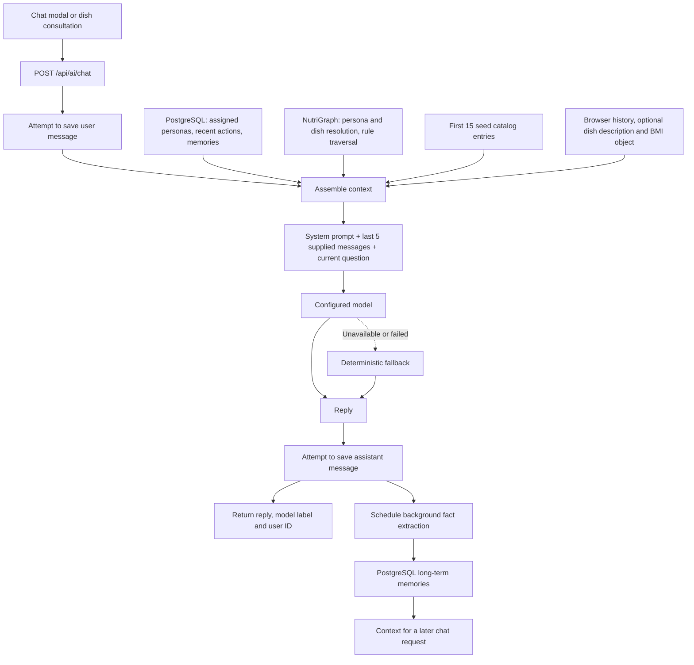
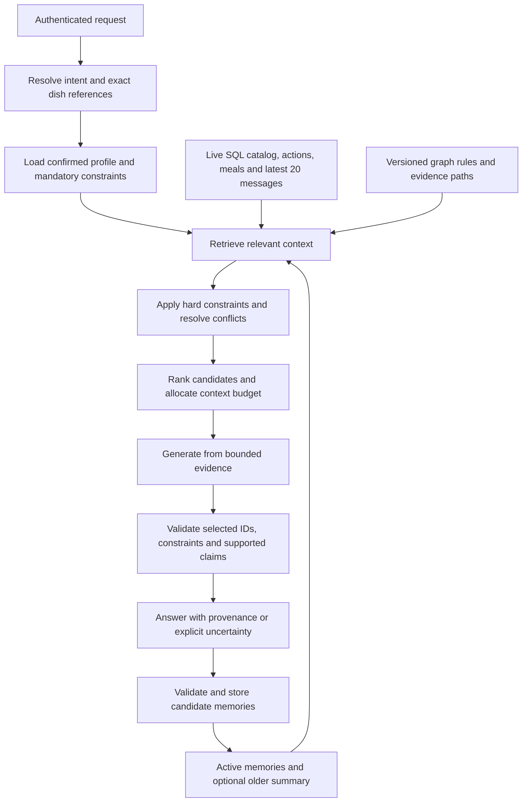

# NutriSea RAG Architecture Report

Date: 7 November 2026\
Repository: `nutrisea-cjwp-the-og-openaisealabs-hackathon-2026`\
Scope: current working-tree implementation, inspected through frontend callers, backend context assembly, database queries, graph loaders, memory extraction, and model calls.

This document is self-contained for sharing with ChatGPT. Findings come from code inspection and local JSON schema inspection. No live model calls, database mutations, or end-to-end runtime tests were performed. Proposed changes are explicitly separated from current behavior.

## 1. Architecture assessment

The active system is **SQL-backed contextual retrieval plus graph-assisted generation**.

The chatbot retrieves personal information from PostgreSQL, computes graph evidence from a file-backed NetworkX graph, appends a fixed catalog excerpt, and sends the assembled context to an OpenAI-compatible chat model.

An embedding client exists, but no active call site connects it to the chatbot or memory retrieval. The inspected flow has no vector index, document chunk retrieval, semantic memory search, query rewriting, reranker, or rolling conversation summary.

Calling this graph-assisted RAG is reasonable. Calling it a completed vector RAG pipeline, a continuously learning personal graph, or a fully grounded clinical assistant would overstate what the code currently implements.

## 2. Current request flow



The application performs retrieval before generation. The model is not currently an agent that chooses retrieval tools, searches the database iteratively, or verifies its own answer through graph tools.

The background memory task is a separate write path. It does not update the graph or recommender automatically.

Primary source: [chat API and context builders](../backend/app/api/chat.py).

## 3. Exactly what is retrieved

| Context source | Selection method | Included content | Important boundary |
| --- | --- | --- | --- |
| Main persona | User assignment, direct persona lookup, or default persona | Template goals, budget, conditions, allergens, tags, occupation, and pain points | Template attributes can be mistaken for actual user facts |
| Side personas | Assigned IDs or default IDs | Alternative archetype descriptions and targets | Not selected dynamically for the current question |
| Recent actions | User ID filter, newest-first order, limit ten | Searches, menu clicks, cart additions, and detail views | No time cutoff or query-relevance filter |
| Durable memories | User ID filter, newest-first order, all rows | Category, fact text, confidence percentage | No top-k selection, expiry, conflict resolution, or token budget |
| Conversation | Browser-supplied history | Last five entries | Does not retrieve the model window from saved database messages |
| Dish context | Optional browser string | Dish name, merchant and supplied nutrition description | Not an authoritative, server-loaded dish record |
| Biometrics | Optional browser object | Formatted BMI, calorie target and goal | Expected field names do not match the main UI object |
| Graph evidence | Resolved persona plus selected/detected dish, otherwise top three graph-ranked dishes | Status, narrative, calories, guideline labels, and up to three evidence paths for a selected dish | Resolution can silently substitute default entities |
| Catalog | First fifteen records of seed_catalog.json | Names, prices, macros, persona mappings and kitchen notes | Same excerpt regardless of question; separate from live SQL catalog |

The helper for recent actions has a default limit of twelve, but the chat endpoint explicitly calls it with ten. The browser's local twenty-action cache is separate and is not what this server query reads.

The long-term-memory formatter omits stored source/timestamp information from the prompt while describing the facts as verified. This removes distinctions the model needs to judge freshness and provenance.

The structured health-profile table, today's meal logs, order history, live cart state, and current merchant inventory are not directly loaded by this chat context builder.

Sources: [database retrieval functions](../backend/app/db/crud.py), [action API](../backend/app/api/actions.py), [AppContext](../frontend/src/context/AppContext.tsx), [chat modal](../frontend/src/components/AiAssistantModal.tsx).

## 4. Knowledge-graph construction

NutriGraph is a process-local NetworkX `MultiDiGraph`, initialized from repository data:

| Source | Intended contribution |
| --- | --- |
| backend/app/data/ontology/clinical_rules.json | Condition metadata and nutrition rules |
| backend/app/data/ontology/ingredient_ontology.json | Ingredients, aliases, sensitivities, benefits, and cooking methods |
| data/personas/processed/personas_master.csv | Persona attributes and condition/allergen relationships |
| data/food/fatsecret_indonesian_foods_expanded.json | Food attributes, nutrients, prices, and preparation information |
| data/food/indonesian_food_persona_mappings.csv | Preassigned persona-food relationships |

Graph relationships include:

- Persona -> condition.
- Persona -> allergen.
- Dish -> ingredient, allergen, or cooking method.
- Condition -> contraindicated ingredient or cooking method.
- Condition -> potentially beneficial ingredient.
- Condition -> nutrient-limit node, when the expected data fields exist.
- Persona -> dynamic memory or learned aversion, when explicitly ingested.

Some dish-ingredient associations are inferred from names and metadata. The graph is not automatically rebuilt from the merchant recipe tables.

### Newly identified rule-schema mismatch

The current loader reads condition fields named:

- `nutrient_ceilings_per_meal`
- `guidelines_reference`

Local inspection of all five condition objects in the supplied rules file found neither field. Instead, the file uses fields such as `max_sodium_per_meal_mg`, `max_fat_per_meal_g`, and a top-level `guidelines_source`.

Consequences in the inspected loader:

1. Condition nodes receive empty nutrient-ceiling dictionaries.
2. No nutrient-limit nodes are created from these condition records.
3. The graph's sodium-ceiling comparison cannot use the limits defined in this file.
4. Condition guideline strings are empty; explanation generation falls back to a generic guideline label.
5. Ingredient and cooking-method relationships can still be created from the separate ingredient ontology. This mismatch does not mean the entire graph is empty.

The condition file also contains contraindicated-ingredient/tag lists that the condition loader does not directly consume; corresponding graph edges depend on the ingredient ontology instead.

This is a data-to-loader contract defect, not merely an opportunity to improve retrieval quality. It should be addressed before relying on graph-generated assurance.

Sources: [graph loading and traversal](../backend/app/services/knowledge_graph.py), [condition rules](../backend/app/data/ontology/clinical_rules.json), [ingredient ontology](../backend/app/data/ontology/ingredient_ontology.json).

## 5. Graph retrieval and ranking

### Entity resolution

The graph resolves a user/persona using direct matches, database assignment lookup, substring/token matching, and finally a default persona.

Dish resolution uses direct IDs, numeric ID conversions, name substrings, token overlap, and a default dish.

Within chat, dish detection first uses the supplied dish description. Otherwise, it scans food names and accepts the first name or overlapping word longer than four characters found in the question. This is lexical matching rather than semantic retrieval or a confidence-calibrated entity resolver.

A generic shared word can therefore select an unintended dish. Unknown identifiers can become plausible-looking evidence for a default dish instead of an explicit “unknown” result.

### Selected-dish traversal

For a resolved dish, the graph checks:

- Shared allergen relationships.
- Condition-to-ingredient contraindications.
- Condition-to-preparation-method contraindications.
- Ingredient benefits.
- Supported nutrient ceilings, if loaded.
- Learned-aversion edges on the persona.

It returns a status, contraindications, benefits, and path evidence. Missing persona/dish node branches currently return `is_safe=True` alongside an unknown severity. Unknown evidence should not be equivalent to a positive safety result.

### General recommendations

When chat does not detect a specific dish, it requests three recommendations. The graph scans its foods, removes dishes failing its checks, and applies this heuristic:

- Start at 70.
- Add 15 for a preassigned persona-food match.
- Subtract up to 20 for distance from the persona's calorie target.
- Add up to 15 for ingredient benefits.
- Add 5 when within budget, otherwise subtract an over-budget penalty capped at 15.
- Clamp the final score to 10–99 and sort descending.

Budget is therefore a soft ranking factor in this method. A displayed percentage is a heuristic score, not a measured probability of suitability.

### Evidence quality

Graph “citations” are stored labels or fallback strings, not retrieved passages from guideline documents with page/section support. The chat route does not return a structured citation list to the UI.

The current prompt describes graph output as clinically verified and deterministic without hallucination. The implementation establishes only that the model received particular graph outputs; it does not establish the correctness or completeness of the underlying rules, recipes, entity match, or generated claims.

## 6. Prompt assembly and generation

The system prompt includes behavioral instructions followed by these blocks:

```text
Persona context
Recent user actions
All long-term memories
Graph evidence
Optional biometric information
Optional selected-dish description
Fixed seed-catalog excerpt
```

The final model request contains:

```text
system: combined instructions and retrieved context
history: last five browser-supplied messages
user: current question
```

Generation uses `OPENAI_MODEL`, temperature 0.3, and a 350-token output cap. The output cap does not limit input-context size. There is no explicit token allocation, relevance compression, or truncation policy for the retrieved memory block.

The browser sends `score` and `targetCalories`, while the backend reads `bmi` and `targetKcal`; it also expects a goal absent from that object. The result can contain default biometrics despite the UI showing actual values.

The main route returns `reply`, `model`, and `user_id`. It does not return selected memory IDs, retrieved dish IDs, context versions, source references, or constraint-validation results. The separate graph-coaching endpoint does return graph evidence with its narrative, but it is not the main chatbot endpoint.

If generation fails or the key is unavailable, the server uses a deterministic graph/persona-based fallback and labels the model `dynamic-context-synthesis`. The frontend has another canned fallback if its request fails. Neither is equivalent to a successful model-grounded answer.

Sources: [chat generation](../backend/app/api/chat.py), [model client](../backend/app/ai/client.py), [graph API](../backend/app/api/graph.py).

## 7. Memory ingestion and the Odysseus-inspired components

The inspected code describes its memory mechanisms as Odysseus-inspired. The implemented pieces are fact extraction, persistence, text deduplication, and a separate graph-memory mutation helper. That description does not establish a complete imported Odysseus retrieval pipeline.

After each chat exchange:

1. Take the last four browser history entries plus the new user/assistant exchange.
2. Extract heuristic candidates from user-role messages.
3. Optionally ask the configured model to extract facts from up to four user messages in that batch.
4. Compare candidates against existing facts using exact/substring matching and token-set Jaccard similarity.
5. Persist qualifying nonduplicates with confidence 0.92 and source `chat_interaction`.

The prompt requests at most two short facts, but the combined candidate pipeline does not enforce a hard two-fact maximum. Persistence checks text length and deduplication; it does not robustly validate negation, subject ownership, temporary intent, or contradictory values.

Important consequences:

- Memory writes happen after the current generation, so an extracted fact affects a later request, not the already-generated reply.
- The task uses an in-process background mechanism with no demonstrated durable retry queue.
- The SQL write does not update the graph, structured profile, or homepage ranking.
- The graph-memory API separately adds keyword-derived aversions to a shared persona node.
- Those graph mutations are not persisted by the inspected method and can differ across processes or disappear after restart.

Sources: [memory extractor](../backend/app/services/memory_extractor.py), [memory schema](../backend/app/models/user_memory.py), [graph-memory implementation](../backend/app/services/knowledge_graph.py).

## 8. Embeddings and conversation continuity

### Embeddings

The embedding helper can call an embeddings HTTP endpoint and normalize vectors. However:

- No active retrieval caller was found in the inspected application code.
- No indexing job, similarity query, vector collection, or memory embedding field is connected to chat.
- Its default endpoint is hardcoded independently of `OPENAI_BASE_URL`.
- The fallback produces zero vectors when no key is available; zero vectors are not meaningful retrieval.
- Passing an empty key into its constructor can still select the configured key through `api_key or settings.OPENAI_API_KEY`.
- The factory catches construction errors; a later HTTP failure in `encode` is not caught there.
- A local embedding-model name/cache path is declared, but that alone does not implement a local model fallback.

These are dormant helper concerns, not explanations for the current chat behavior, because chat does not call the helper.

### Conversation continuity

Messages are stored under user ID without a separate conversation entity. That can support one logical thread per user, but continuity is not complete:

- The modal starts with a local welcome message.
- It does not fetch saved history on opening.
- The history endpoint retrieves the oldest fifty messages.
- Generation trusts browser history instead of constructing its window from the database.
- Dish consultation sends no history.

The requested target is one persistent conversation per authenticated user, full history fetched at opening, latest twenty messages displayed with upward reveal, and a twenty-message model context window. It needs an explicit rule for whether the current question counts toward twenty, without duplication. User and assistant messages count; system instructions are separate.

Sources: [embedding helper](../backend/app/ai/embeddings.py), [message schema](../backend/app/models/chat_message.py), [chat modal](../frontend/src/components/AiAssistantModal.tsx), [dish consultation](../frontend/src/app/menu/[id]/page.tsx).

## 9. Main architectural failure modes

| Failure mode | Current cause | Effect |
| --- | --- | --- |
| Wrong user context | Client-supplied IDs, demo defaults, inconsistent identity sources | Another user's or template's context can be selected |
| Incorrectly authoritative evidence | Persona assumptions and extracted facts described as verified | Unsupported personal/health claims |
| Missing constraints | Rule-schema mismatch and disconnected SQL memories | Graph checks do not reflect all available restrictions |
| Wrong dish grounding | Loose matching and default substitution | Explanation refers to a different dish |
| Conflicting food data | Live catalog, seed catalog, and file-backed graph are separate | Different prices, recipes, availability, or nutrition across surfaces |
| Stale or excessive memory | All facts loaded without expiry or relevance filtering | Contradictions, distraction, and growing input cost |
| Weak conversation continuity | Browser-only five-message model window | Missing earlier user decisions after reload or another chat surface |
| Prompt injection exposure | User-derived strings interpolated into system context; arbitrary history role strings accepted | Retrieved content or supplied roles can be treated as instructions |
| Unsupported generated claims | No structured evidence contract or post-generation constraint check | Fluent output can exceed retrieved facts |
| Incomplete observability | No retrieval trace or source IDs in main response | Hard to explain why a recommendation changed or failed |

These are code-level findings and risks, not claims that every failure has been reproduced in production.

The separate lunch-planner API has another important inconsistency: it restores the full catalog when no filtered candidates remain. Fixing chatbot retrieval alone will not make all recommendation surfaces obey the same constraints.

## 10. Proposed RAG architecture

The next iteration should unify identity, constraints, food records, and memory validity before introducing vector search.



Recommended responsibilities:

1. **Identity:** derive ownership from authentication. Separate user facts from shared persona templates and shared food knowledge.
2. **Profile:** load explicit restrictions directly for every relevant request. Never depend on semantic similarity to retrieve a critical constraint.
3. **Intent:** distinguish dish explanation, meal selection, preference correction, temporary request, and general information.
4. **Catalog retrieval:** use current records and exact IDs; retrieve candidates by relevant filters instead of appending the first fifteen seed items.
5. **Memory retrieval:** select active relevant facts using category, temporal scope, source, recency, and entity links. Add semantic retrieval only when simpler selection is insufficient.
6. **Graph retrieval:** validate loader schemas and identifiers; attach rules to traceable sources; return unknown when evidence is missing.
7. **Context budgeting:** reserve space for instructions, mandatory constraints, recent conversation, evidence, and output. Drop low-value context first and preserve traceability.
8. **Generation:** keep retrieved text clearly identified as data. Reconstruct allowed message roles server-side. Prompt boundaries must be backed by authorization and validation.
9. **Validation:** use structured dish selections and deterministic rechecks. Enforce restrictions outside the language model and handle an empty candidate set honestly.
10. **Memory updates:** preserve source message IDs, subject, time scope, confirmation state, supersession, and deletion. Propagate valid changes to downstream ranking and graph inputs.
11. **Observability:** record selected source IDs, graph/rule version, candidate exclusions, context size, model/fallback mode, latency, and validation outcome. Avoid unnecessary raw health data in logs.

A proposed context record could carry `source_type`, `source_id`, `user_id`, `entity_id`, `content`, `observed_at`, `valid_until`, `verification_state`, and `source_version`. Retrieval relevance and factual reliability should remain separate scores.

## 11. Implementation order and evaluation

**First:** fix ownership, the graph-rule schema mismatch, default entity substitution, biometric field mapping, and fail-open recommendation paths.

**Next:** finish persistent chat history, use canonical profile/live dish data, add provenance and conflict-aware memory selection, and connect valid preference changes across recommendation surfaces.

**Then:** add older-conversation summaries, optional semantic retrieval, reranking, durable background processing, and broader retrieval evaluation where measured need justifies them.

Acceptance cases should include:

- User A cannot retrieve User B's memories.
- An unknown dish produces uncertainty instead of another dish's explanation.
- Every declared nutrient-rule field maps to an exercised graph check.
- A new explicit restriction affects the next relevant recommendation.
- “My mother has diabetes” does not become the user's condition.
- “No rice today” remains temporary.
- A corrected budget supersedes the old value.
- Merchant recipe changes reach retrieval and invalidate stale evidence.
- An empty eligible catalog produces no fabricated replacement.
- Chat reload restores history and respects the twenty-message rule.
- Model or embedding failure is visible and does not weaken mandatory constraints.
- A long history stays within the configured context budget without dropping critical restrictions.

Measure retrieval relevance, missed constraints, entity-resolution errors, unsupported claims, memory-attribution errors, correction handling, context size, latency, and cost. Evaluate retrieval quality separately from answer fluency.

## 12. Prompt to send with this report

> Review the attached NutriSea RAG architecture report as a senior AI architect. Treat its code-inspected behavior as the current baseline and its proposed architecture as unimplemented. Do not assume access to my repository.
>
> Explain the current SQL-plus-graph retrieval flow, then propose the smallest practical architecture that makes user preferences, constraints, conversation history, live menu data, and graph evidence consistent. Prioritize the discovered rule-schema mismatch, identity isolation, unknown-entity handling, and memory provenance before adding vector search.
>
> Provide: (1) a current-versus-target diagram; (2) a component and data-contract table; (3) retrieval and context-budget policies; (4) a memory update/correction lifecycle; (5) a staged implementation plan; and (6) acceptance tests and evaluation metrics. Explain when semantic retrieval would add value and when SQL filters or graph traversal are sufficient.
>
> Preserve our requirement of one persistent conversation per authenticated user, full saved history available when chat opens, latest twenty messages initially visible with upward reveal, and a twenty-message model context window. Explicitly define whether the current user message counts toward that window.
>
> Distinguish confirmed personal facts, template assumptions, behavioral observations, model inferences, and source-backed food knowledge. Do not equate a graph match or a fluent answer with clinical validation. Use concrete Indonesian dining examples and identify which architecture choices are essential for a hackathon demo versus later scaling.

Related local document: [AI Integration and User Understanding Report](AI_INTEGRATION_REPORT.md).
