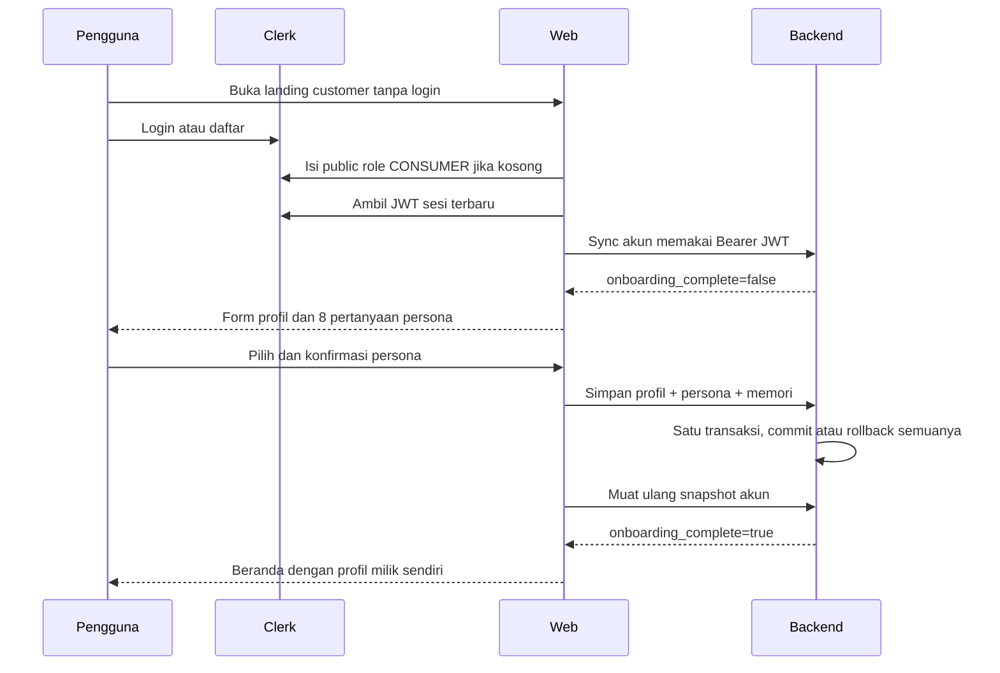

# Audit alur akun dan onboarding

Tanggal: 7 November 2026. Ruang lingkup: seluruh jalur yang menghubungkan login,
role Clerk, JWT, bootstrap akun, profil, onboarding persona, pergantian akun dan
checkout. Ini bukan audit keamanan seluruh layanan AI, pembayaran atau deployment.

## Temuan sebelum perbaikan

| Temuan | Dampak |
| --- | --- |
| Bootstrap membaca `unsafeMetadata.main_persona_id`, sedangkan beranda membaca database dan localStorage | Akun yang sama dapat dianggap selesai dan belum selesai oleh halaman berbeda |
| Sinkronisasi `AppShell` berjalan di background dan mengabaikan respons gagal | UI bisa melanjutkan sebelum akun backend tersedia |
| Persona, biometrik dan metadata Clerk ditulis dalam request terpisah | Penyimpanan parsial terlihat seperti onboarding berhasil |
| Backend mengisi profil awal dari persona contoh | Biometrik, alergi atau kondisi medis referensi bisa dianggap sebagai fakta pengguna |
| Persona disimpan di localStorage tanpa pemisahan akun | Pergantian akun bisa menampilkan personalisasi pengguna sebelumnya |
| Default data demo dan fallback ID pengguna muncul pada beberapa komponen | Akun baru atau tamu berisiko melihat/mencatat data contoh sebagai data sendiri |
| Bootstrap membandingkan Origin browser dengan URL bind internal | `localhost` dapat ditolak ketika Next menggunakan `0.0.0.0` |
| Pengujian sebelumnya hanya membuktikan fungsi terpisah dan HTTP 200 | Belum membuktikan urutan bootstrap sampai penyimpanan persona dan pergantian akun |

## Kontrak data setelah perbaikan

| Data | Sumber yang dipakai |
| --- | --- |
| Identitas akun | Clerk authenticated user ID |
| Role dan merchant IDs | Public metadata Clerk dalam JWT yang diverifikasi backend |
| Selesai onboarding | Database: persona valid dan health profile milik akun tersebut tersedia |
| Biometrik dan preferensi yang dimasukkan | Health profile database |
| Persona yang dipilih | Assignment pada app_user, mengacu katalog persona |
| Katalog seed persona | Referensi untuk matching dan pilihan pengguna; tidak menjadi identitas atau biometrik pengguna baru |
| Cache tampilan | Snapshot backend yang terikat user ID; tidak menentukan izin |

## Alur akun baru

Akun lama dengan profil dan persona valid tidak mengulang onboarding. Metadata
Clerk yang kosong tidak menyebabkan profil contoh disalin. Role admin/merchant
yang sudah ada tetap dipertahankan dan tidak diberi hak dari kolom role legacy.
Tamu tetap dapat menjelajah menu; pemesanan membutuhkan login dan onboarding.

## Jalur kode yang ditinjau

- Frontend: root layout, proxy Clerk, sign-in/up, dashboard, account session gate,
  AppShell, AppContext, onboarding role/persona, profile editor/summary, home,
  menu detail, BMI, cart, assistant dan SeaBank modal, scanner.
- Backend: verifier JWT/public metadata, user sync dan user routes, persona
  matching/assignment, model user/profile/persona, CRUD profil, bootstrap tabel,
  script seed dan migrasi katalog, approval merchant dan CLI role operator.
- Seed master persona dibaca sebagai katalog; tidak menjalankan migrasi atau
  menulis akun/profil nyata untuk kebutuhan pengujian ini.

## Bukti pengujian

- Tes backend terisolasi membuktikan akun baru belum selesai, formulir disimpan
  dengan nilai pengguna yang berbeda dari referensi, akun lama kembali tanpa
  onboarding ulang, akun lain tidak mewarisi profil, dan kegagalan setelah
  penulisan profil membatalkan keseluruhan transaksi.
- Tes frontend membuktikan urutan Clerk → refresh token → sync backend,
  pengalihan ke formulir persona, pembatalan sesi lama, pemuatan ulang setelah
  konfirmasi, kegagalan yang terlihat, serta keranjang tidak melintas akun.
- Typecheck dan production build dijalankan. Tes memakai Clerk yang dimock dan
  SQLite terisolasi. Login browser dengan kredensial pengguna nyata serta isi
  JWT aktual tetap merupakan pemeriksaan live terpisah.
- Konfigurasi instance tetap membutuhkan custom session claim
  `{"metadata":"{{user.public_metadata}}"}`. Pengaturan ini kemudian berhasil
  diterapkan melalui CLI resmi Clerk pada instance development proyek dan
  diverifikasi melalui config pull. Konfigurasi sebelumnya `session: null`.
  Browser perlu mengambil token baru setelah pengaturan ini disimpan.
- File migrasi bahan `002_ingredient_system.sql` memiliki perubahan di luar
  pekerjaan onboarding ini dan tidak dijalankan atau dipulihkan oleh audit ini.
