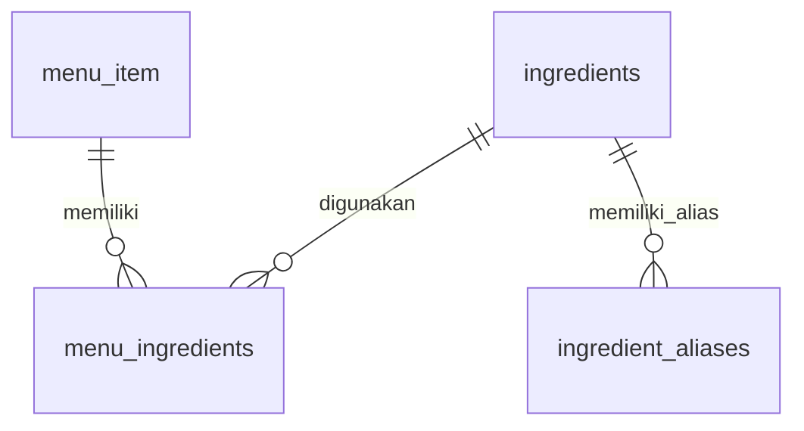

# Ingredient Management & Autocomplete — Implementation Report

Tanggal: 6 November 2026. Status: kode selesai, menunggu persetujuan migrasi dan konfigurasi akses sebelum penggunaan live.

## 1. Sumber instruksi dan hasil implementasi

Path yang diminta `prompts/implement-ingredient-system.md` tidak ada pada workspace. Instruksi ditemukan di `docs/implement-ingredient-system.md` dan diterapkan dengan referensi `docs/full-database-analysis.md`. Framework yang digunakan tetap FastAPI, SQLAlchemy, Pydantic, Next.js App Router, React, TypeScript, serta Clerk. Panduan Next.js lokal dan `frontend/AGENTS.md` dibaca sebelum perubahan frontend.

Implementasi mencakup:

- Master bahan dengan nama kanonis, nama ternormalisasi unik, kategori, satuan default, alias, status aktif, dan timestamp.
- Pencarian case-insensitive nama/alias, prefix sebelum substring, urutan deterministik, escaping wildcard literal, parameter binding, limit, serta pagination.
- Autocomplete reusable dengan minimum satu karakter, debounce 275 ms, loading/empty/error state, keyboard ArrowUp/ArrowDown/Enter/Escape, clear input, click outside, combobox/listbox semantics, dan perlindungan respons kedaluwarsa.
- Pemilihan beberapa bahan dengan takaran, satuan, pengubahan/penghapusan pilihan, pencegahan duplikasi berdasarkan ID, dan validasi numerik yang sama dengan backend.
- Halaman `/admin/ingredients`: tabel pencarian, pagination, tambah/edit melalui dialog, pengelolaan alias, konfirmasi nonaktifkan, loading, validasi, serta notifikasi sukses/gagal.
- Integrasi pada form create/edit menu merchant yang sudah ada. Menu, tag, dan komposisi disimpan dalam satu transaksi. Omit komposisi mempertahankan data lama; `items: []` sengaja mengosongkannya.
- Optimistic concurrency komposisi menggunakan content version SHA-256 dan lock baris menu pada PostgreSQL. Versi lama ditolak dengan 409.
- Penonaktifan bahan dan menu mempertahankan relasi serta histori; tidak ada hard delete atau backfill komposisi hasil tebakan.
- Verifikasi token Clerk pada backend, admin-only master mutations, serta kepemilikan merchant untuk menu dan outlet. Role switch frontend dan `app_user.role` tidak digunakan sebagai sumber otorisasi.

Tidak ada koneksi baru ke PostgreSQL selama implementasi/pengujian ini. Tidak ada migrasi, seed, atau perubahan record pada database yang terhubung.

## 2. File yang dibuat dan diubah

### Backend baru

| File | Fungsi |
| --- | --- |
| `backend/app/models/ingredient.py` | Model tiga tabel, FK, unique/check constraints, dan index |
| `backend/app/schemas/__init__.py` | Package schema |
| `backend/app/schemas/ingredients.py` | Schema Pydantic, normalisasi, takaran/satuan/versi |
| `backend/app/services/ingredients.py` | Query katalog, persistence master, pembacaan dan penggantian komposisi |
| `backend/app/api/ingredients.py` | Router master dan komposisi menu |
| `backend/app/core/ingredient_auth.py` | Verifikasi RS256/JWKS Clerk dan dependency otorisasi |
| `backend/migrations/002_ingredient_system.sql` | Sumber migrasi PostgreSQL aditif untuk review; belum dieksekusi |
| `backend/tests/test_ingredients.py` | Test API, transaksi, constraint, auth, dan proteksi migrasi |
| `scripts/run_backend_tests.py` | Runner seluruh test pada SQLite sementara, tanpa membaca `.env` produksi |

### Backend/config yang diubah

- `backend/app/models/__init__.py`: registrasi dan ekspor model baru.
- `backend/app/api/merchant.py`: proteksi akses, daftar merchant yang berhak diakses, ID menu server yang unik, persistence atomik, payload komposisi, serta penonaktifan menu.
- `backend/app/db/crud.py`: `upsert_menu_item(..., commit=False)` untuk transaksi service; empty tag array sekarang benar-benar menghapus tag, sementara field yang dihilangkan mempertahankan tag.
- `backend/app/main.py`: registrasi router; startup schema creation menjadi opt-in.
- `backend/app/core/database.py`: helper schema lama selalu mengecualikan tiga tabel ingredient dari `create_all`.
- `backend/app/core/config.py`: konfigurasi Clerk, opt-in startup DDL, dan guard test SQLite yang tidak membaca environment file produksi.
- `backend/requirements.txt`: menambahkan `PyJWT[crypto]>=2.12.0,<3` untuk verifikasi kriptografis.
- `backend/.env.example`: contoh konfigurasi auth tanpa kredensial.
- `.gitignore`: mengecualikan dependensi test lokal dan cache TypeScript.

### Frontend baru

| File | Fungsi |
| --- | --- |
| `frontend/src/lib/api.ts` | Base URL, parsing response, dan error API bersama |
| `frontend/src/services/ingredient-types.ts` | Tipe kontrak, satuan, validasi takaran, serializer payload |
| `frontend/src/services/ingredient-api.ts` | Integrasi fetch dan bearer token dari Clerk |
| `frontend/src/components/ingredients/IngredientAutocomplete.tsx` | Combobox dan editor multi-bahan |
| `frontend/src/components/ingredients/IngredientGuard.tsx` | Gate UI berdasarkan akses yang diverifikasi backend, terikat identitas pengguna |
| `frontend/src/components/ingredients/IngredientDialog.tsx` | Dialog native dengan fokus modal dan penanganan Escape |
| `frontend/src/components/ingredients/IngredientManagement.tsx` | Pengelolaan master, alias, dan status aktif |
| `frontend/src/components/ingredients/ingredients.module.css` | Layout responsif memakai token desain aplikasi |
| `frontend/src/app/admin/ingredients/page.tsx` | Route server dengan `requireAuth()` dan gate admin backend |
| `frontend/src/components/ingredients/IngredientAutocomplete.test.tsx` | Pengujian interaksi DOM React |
| `frontend/src/services/ingredients.test.ts` | Pengujian payload, takaran, serta error API |
| `frontend/tests/dom-setup.ts` | DOM terisolasi melalui jsdom |
| `frontend/tests/register-css.mjs` | Loader CSS module khusus test, tanpa mengubah build produksi |
| `frontend/.env.example` | Contoh origin backend publik |

### Frontend yang diubah

- `frontend/src/app/merchant/page.tsx`: editor bahan pada modal menu, load komposisi/version, payload atomik, pemilihan merchant, token API, gate akses, dan kegagalan simpan yang tetap mempertahankan form. Tidak lagi menyatakan mutasi menu berhasil lewat fallback lokal.
- `frontend/src/app/admin/page.tsx`: tautan ke pengelolaan bahan.
- `frontend/package.json` dan `frontend/package-lock.json`: test script, typecheck script, serta dev dependencies `tsx`, `jsdom`, dan tipe jsdom. Tidak ada library UI produksi tambahan.
- `frontend/.gitignore`: menyertakan contoh `.env.example` sambil tetap mengabaikan environment file pribadi.

File analisis/prompt dan perubahan workspace yang telah ada sebelumnya tidak dihapus atau ditimpa. Tidak dilakukan commit atau push.

## 3. Database model dan keputusan desain

Skema relevan diverifikasi terhadap model/menu migration yang tersedia dan inventaris PostgreSQL dari analisis sebelumnya: PK `menu_item.id` tetap varchar(32); merchant/menu/outlet yang ada dipakai kembali. Tidak dilakukan pemeriksaan ulang lewat koneksi live pada fase implementasi.

Tiga tabel baru:

| Tabel | Key dan aturan |
| --- | --- |
| `ingredients` | UUID aplikasi disimpan sebagai varchar(36), mengikuti pola ID UUID string yang sudah digunakan proyek. `normalized_name` unik; nama tidak kosong; satuan dibatasi; status aktif dan timestamps. |
| `ingredient_aliases` | PK UUID string; FK ingredient CASCADE; unique `(ingredient_id, normalized_alias)`; alias tidak kosong. Alias ambigu lintas bahan diperbolehkan, kandidat tetap dibedakan dengan nama dan ID kanonis. |
| `menu_ingredients` | PK gabungan `(menu_item_id, ingredient_id)`; FK menu CASCADE dan ingredient RESTRICT; quantity numeric(12,3), positif dan maksimum 999999.999; unit terkontrol; timestamp. |

Kategori disimpan sebagai varchar pada master, bukan tabel kategori keempat: instruksi implementasi memperbolehkan schema yang lebih sederhana, dan belum memerlukan lifecycle kategori terpisah. Kategori dapat diedit lewat form master. Alias dikelola bersama master dalam satu transaksi.

Satuan: `gram`, `kg`, `ml`, `liter`, `pcs`, `tsp`, `tbsp`. Takaran wajib ketika bahan dipilih. Penggunaan `pcs` tidak otomatis dikonversi menjadi gram. Tidak ada kalkulasi ulang gizi atau klaim alergen dari daftar bahan ini.

Normalisasi di API memakai Unicode NFKC, whitespace yang dirapikan, dan lowercase. Nama tampilan dipertahankan. Panjang sesudah normalisasi divalidasi; karakter NUL ditolak. Writer SQL lain harus mengikuti kontrak normalisasi yang sama, karena unique constraint diterapkan pada hasil normalisasi, bukan fungsi NFKC PostgreSQL.

Index baru: unique nama ternormalisasi, index prefix varchar_pattern_ops nama/alias, index FK alias, dan reverse lookup ingredient–menu. Tidak menambahkan extension. Pencarian substring dapat melakukan scan pada master; untuk katalog besar, evaluasi pg_trgm pada staging melalui persetujuan migrasi terpisah. Index prefix bukan jaminan semua substring query memakai index.



## 4. Migrasi: belum disetujui dan belum dijalankan

File yang direview: `backend/migrations/002_ingredient_system.sql`.

Proyek memiliki dependency Alembic tetapi tidak memiliki environment/config/revision chain Alembic. Migrasi mengikuti konvensi yang benar-benar ada: source SQL PostgreSQL dalam `backend/migrations`, seperti `init_postgres.sql`. Tidak menjalankan ulang init SQL, membuat baseline fiktif, atau men-stamp database.

Karakteristik file:

- Transaksi tunggal, search_path public, lock timeout 3 detik, statement timeout 30 detik.
- Hanya membuat tiga tabel baru dan index miliknya.
- Tidak mengubah tabel lama, record, enum, atau constraint yang telah ada.
- Tidak menggunakan `IF NOT EXISTS` untuk menyembunyikan schema parsial; collision harus menggagalkan transaksi agar ditinjau.
- Tidak memasukkan master bahan, alias, atau komposisi menu otomatis.

Setelah persetujuan eksplisit, operator perlu:

1. Memastikan target dan backup/recovery sesuai environment yang disetujui; periksa ketiga nama tabel belum ada serta `public.menu_item.id` tetap varchar(32).
2. Meninjau SQL dan mencobanya pada database staging yang disetujui terlebih dahulu.
3. Menggunakan koneksi operator yang aman, tanpa menyalin password ke command line/report. Contoh pemanggilan setelah konfigurasi `PGSERVICE` operator tersedia:

   ```powershell
   psql --set=ON_ERROR_STOP=1 --file=backend/migrations/002_ingredient_system.sql
   ```

4. Memverifikasi tiga tabel, PK/FK/unique/check, dan index; tidak menjalankan file dua kali.
5. Mengaktifkan deployment kode dan mengisi master bahan yang dikurasi melalui halaman admin/API setelah auth siap.

Perintah di atas hanya dokumentasi dan **tidak dijalankan**. Tidak ada dry-run migration dengan rollback pada database yang terhubung.

Rollback pertimbangan: bila SQL gagal sebelum commit, transaksi tidak boleh dipertahankan. Sesudah migration berhasil, rollback aplikasi disarankan mempertahankan tabel dan komposisi baru. Menonaktifkan fitur tidak memerlukan penghapusan data. Penghapusan tabel setelah data terisi adalah tindakan destruktif terpisah dan tidak disediakan sebagai rollback otomatis. Migrasi data mundur atau restore harus disetujui dan direncanakan tersendiri.

`AUTO_CREATE_TABLES=false` menjadi default. Bahkan jika opt-in legacy schema dinyalakan untuk development lokal, helper `create_all_tables()` mengecualikan tiga tabel ingredient. Tidak ada jalur startup yang menerapkan migration baru.

## 5. Endpoint dan kontrak integrasi

| Method/path | Akses | Fungsi |
| --- | --- | --- |
| `GET /api/ingredients?search=ba&limit=8&page=1` | Baca publik, hanya aktif | Nama/alias, exact lalu prefix lalu substring; pagination; limit 1–50, search maksimum 80 karakter |
| `GET /api/ingredients/access` | Sesi Clerk valid | Capability admin/merchant dan merchant IDs dari metadata tepercaya |
| `GET /api/ingredients/manage` | Admin | Daftar termasuk nonaktif, pencarian dan pagination |
| `GET /api/ingredients/{id}` | Baca publik | Detail bahan; ID tidak valid ditolak |
| `POST /api/ingredients` | Admin | Create master; 201; nama duplikat 409 |
| `PUT /api/ingredients/{id}` | Admin | Edit/rename/kategori/satuan/alias/status aktif |
| `DELETE /api/ingredients/{id}` | Admin | Deactivate; mempertahankan baris dan komposisi |
| `GET /api/dishes/{dish_id}/ingredients` | Baca publik | Komposisi menu dan content version |
| `PUT /api/merchant/dishes/{dish_id}/ingredients` | Merchant pemilik atau admin | Replace-all atomik dengan version wajib |
| `GET /api/merchant/dishes` | Merchant/admin | Daftar hanya menu aktif yang dimiliki; admin dapat melihat semua; metadata merchant minimal untuk form |
| `POST /api/merchant/dishes` | Merchant/admin | Create menu dan komposisi opsional dalam satu transaksi, 201 |
| `PUT /api/merchant/dishes/{dish_id}` | Merchant pemilik/admin | Update menu/tag/komposisi atomik; omit komposisi mempertahankannya |
| `DELETE /api/merchant/dishes/{dish_id}` | Merchant pemilik/admin | Menonaktifkan menu, mempertahankan histori |
| `GET /api/merchant/outlets` | Merchant/admin | Scope pemilik diverifikasi sebelum data outlet diambil |
| `POST /api/merchant/outlets/{id}/toggle-status` | Merchant pemilik/admin | Proteksi ownership pada flow merchant yang sudah ada |

Response daftar master: `{items, total, page, limit, has_more}`. ID response berasal dari database, tidak dari suggestion hardcoded. Query kosong digunakan untuk daftar/pagination; autocomplete baru mengirim request jika sedikitnya satu karakter.

Payload komposisi:

```json
{
  "items": [
    {"ingredient_id": "<uuid-dari-API>", "quantity": "3.125", "unit": "gram"}
  ],
  "version": "<version-dari-GET-komposisi>"
}
```

Untuk create menu, frontend menggunakan SHA-256 dari array kosong sebagai versi komposisi awal. Pada payload create/edit menu, objek tersebut berada di field `ingredients`. Path lain dan field consumer lama dipertahankan; komposisi dibaca melalui endpoint terpisah agar katalog lama tidak memerlukan query ke tabel baru sebelum migration diterapkan.

Validasi: UUID, maksimum 100 bahan, tidak ada ID berulang, referensi ditemukan, quantity positif dan maksimum tiga desimal, serta unit terkontrol. Bahan nonaktif boleh dipertahankan tanpa perubahan atau dihapus dari resep lama; tidak boleh ditambahkan atau diubah takarannya. 401/403 untuk akses, 404 untuk ID tidak ditemukan, 409 untuk nama/ID duplikat atau version conflict, 422 untuk input/referensi, dan 503 dengan pesan eksplisit ketika schema belum diprovision.

## 6. Konfigurasi autentikasi dan environment

Backend memerlukan instalasi requirements dan konfigurasi berikut pada environment deployment, tanpa mengubah file kredensial dalam laporan ini:

```dotenv
CLERK_ISSUER=https://your-instance.clerk.accounts.dev
CLERK_SECRET_KEY=<YOUR_CLERK_SECRET_KEY>
CLERK_AUDIENCE=
CLERK_AUTHORIZED_PARTIES=http://localhost:3000,http://127.0.0.1:3000
AUTO_CREATE_TABLES=false
```

Issuer harus URL instance yang tepat, HTTPS. Public keys diambil dari `issuer/.well-known/jwks.json`, di-cache, dan dipakai hanya untuk RS256. Signature, issuer, expiry, issued-at, not-before, subject, authorized party, serta status sesi diverifikasi. Audience diverifikasi jika deployment menggunakannya. Issuer tidak dipilih dari token yang belum diverifikasi. Tidak ada token admin statis atau bypass development.

Identitas diverifikasi dari JWT Clerk standar; custom session claims tidak diperlukan.
Setelah verifikasi signature dan claim standar, backend membaca `public_metadata` akun
melalui Clerk Backend API menggunakan `CLERK_SECRET_KEY`. Metadata tidak di-cache agar
pencabutan akses berlaku pada permintaan berikutnya. Konsekuensinya adalah satu request
Clerk per request backend terautentikasi; outage/rate limit ditampilkan sebagai 503 dan
akses tetap ditolak. Public metadata tetap menjadi sumber assignment operator, terutama admin.
Pengajuan merchant yang disetujui juga memberi membership melalui `merchant_application`
di PostgreSQL. Record APPROVED beserta merchant/outlet dibuat dalam satu transaksi.
Tidak ada fallback ke role lokal, unsafe metadata, atau kolom legacy `app_user.role`.

Public metadata harus dikelola oleh operator/backend tepercaya di Clerk:

- Admin: `{"role": "SHOPEE_ADMIN"}`.
- Merchant: `{"role": "MERCHANT_ADMIN", "merchant_ids": ["<merchant-id-yang-sudah-ada>"]}`.

Akun tanpa assignment mendapat `CONSUMER`. Merchant hanya dapat mengelola menu
untuk `merchant_ids` yang ditetapkan operator, sedangkan admin dapat mengakses seluruh
merchant. Nilai role yang sah: `CONSUMER`, `MERCHANT_ADMIN`, `SHOPEE_ADMIN`.
Operator menetapkan akses melalui Clerk Dashboard public metadata atau CLI berikut:

```powershell
python scripts/set_account_access.py --user-id user_... --role MERCHANT_ADMIN --merchant-id MTR-...
```

CLI memvalidasi ID merchant pada database dan akun pada instance Clerk, lalu menulis
public metadata menggunakan secret key server. Tidak mengubah unsafe metadata atau
menebak kepemilikan dari email/nama. Jalankan hanya untuk assignment yang sudah diverifikasi.
Untuk pencabutan, jalankan dengan `--role CONSUMER` tanpa `--merchant-id`.

Customer dapat mendaftarkan usaha di `/merchant/register`. Tautan tersedia dari Profil,
header, tab Merchant, navigasi Mitra, dan onboarding. Status pengajuan: PENDING, APPROVED,
atau REJECTED. Pengajuan ditolak dapat diperbaiki dan dikirim ulang. Satu akun memiliki
satu pengajuan; pengiriman ganda ditolak. Pemohon hanya dapat membaca pengajuan sendiri.

Admin memproses pengajuan di `/admin/merchant-applications`, ditautkan dari dashboard.
Alasan penolakan wajib diisi. Persetujuan membuat merchant dan outlet awal dengan
rating/review nol, belum tersertifikasi higienis, dan belum dibuka. Pengajuan dikunci
selama review, versi data diperiksa, dan retry keputusan yang sama bersifat idempotent.
Hak akses merchant berasal dari pengajuan APPROVED, sehingga tidak membutuhkan update
Clerk yang terpisah dari transaksi database. Customer tetap dapat berbelanja.

Deploy migration `backend/migrations/003_merchant_applications.sql` sebelum restart backend.
DDL pendaftaran tidak dijalankan oleh startup. API baru:

- `GET/POST /api/merchant-applications/me`: status dan pengajuan akun sendiri.
- `GET /api/admin/merchant-applications`: daftar untuk admin, filter status dan pagination.
- `POST /api/admin/merchant-applications/{id}/review`: persetujuan/penolakan oleh admin.

Frontend memeriksa status pending setiap 15 detik saat halaman pengajuan terbuka dan
memuat ulang hak akses saat disetujui atau ketika jendela kembali aktif.

Tab dan onboarding hanya memilih tampilan yang diizinkan oleh backend. Penyimpanan
`nutrisea_user_role` adalah preferensi tampilan. Endpoint `/api/users/sync` memerlukan
sesi dan hanya menyinkronkan akun sendiri; role database selalu dicerminkan dari
assignment tepercaya. Endpoint legacy `/{user_id}/role` menolak perubahan hak akses.
Seluruh router merchant/admin memerlukan izin, termasuk endpoint AI dan metrik admin.
Perubahan assignment terlihat pada permintaan backend berikutnya; refresh halaman
untuk memperbarui pilihan tampilan. Sesi valid tanpa metadata token bukan kesalahan 401.

Frontend memakai `NEXT_PUBLIC_API_URL` sebagai origin tanpa suffix `/api`, default development `http://127.0.0.1:8000`. Token diambil dengan `useAuth().getToken()` dan dikirim sebagai Authorization bearer; tidak ditulis ke localStorage. Browser tidak pernah terhubung langsung ke PostgreSQL. Konfigurasi Clerk yang sudah ada tetap digunakan. Sesuaikan `CLERK_AUTHORIZED_PARTIES` dan CORS environment deployment ketika origin frontend berubah.

Referensi auth: [Clerk manual JWT verification](https://clerk.com/docs/guides/sessions/manual-jwt-verification), [Clerk custom session tokens](https://clerk.com/docs/guides/sessions/customize-session-tokens), dan [PyJWT API](https://pyjwt.readthedocs.io/en/latest/api.html).

## 7. Frontend architecture dan perilaku kegagalan

`IngredientAutocomplete` menerima `value`, `onChange`, dan fungsi `search`, sehingga tidak terikat halaman admin/merchant ataupun provider autentikasi dalam test. Komponen ini mencakup selected ingredient rows; payload persistence dibentuk oleh helper terpisah agar nama tampilan tidak menggantikan ID.

`IngredientManagement` menggunakan API hook bersama untuk master. Route server memastikan login; gate client meminta capability yang ditentukan backend. Admin actions tidak dirender untuk akses yang ditolak. Gate terikat user ID agar sesi yang berubah tidak mewarisi akses tampilan pengguna sebelumnya.

Form merchant memuat resep saat edit dan menyimpan version yang sama bersama pilihan. Jika resep gagal dimuat, simpan dinonaktifkan hingga form dibuka ulang. Jika simpan gagal, form dan input dipertahankan, menampilkan pesan server. Tidak ada ingredient suggestion fallback, produksi seed diam-diam, atau sukses lokal ketika request menu gagal.

Saran didebounce 275 ms; request lama di-abort dan generation ID mencegah hasil terlambat menggantikan query baru. Escape/click outside juga membatalkan hak response pending untuk memperbarui popup. Takaran nonvalid ditandai dan divalidasi lagi pada submit serta backend. Dialog admin memakai native dialog agar fokus modal/keyboard mengikuti browser.

## 8. Hasil pengujian

Pengujian tidak membaca `.env` backend produksi. Runner menyalakan subprocess dengan `NUTRISEA_TESTING=1`, SQLite file sementara untuk test lama, dan SQLite in-memory untuk test ingredient. Guard menolak DATABASE_URL non-SQLite ketika mode test aktif. Schema test dibentuk hanya di database disposable; **file migration tidak dijalankan**.

| Pemeriksaan | Hasil |
| --- | --- |
| `python scripts/run_backend_tests.py` | **49 test lulus**, termasuk 21 test ingredient/auth/safety dan 28 test lama |
| `npm test` di frontend | **19 test lulus**, termasuk 8 interaksi combobox, 3 validasi/API, dan 8 scorer lama |
| `npm run typecheck` | Lulus setelah perbaikan tipe gate akses; build final juga menjalankan TypeScript dengan sukses |
| `npm run build` | Lulus; route `/admin/ingredients` masuk build Next.js |
| ESLint modul ingredient baru dan test utilities | **0 error, 0 warning** |
| `npm run lint` seluruh frontend | Belum lulus karena **35 error dan 77 warning lama** di area aplikasi yang ada |
| Perbandingan lint file merchant/admin dengan `git show HEAD:<file>` | Error merchant tetap 5, admin tetap 2 dengan rule yang sama; warning merchant turun 19 menjadi 16, admin tetap 10. Modul baru tidak menambah error |
| `git diff --check` | Lulus |

Cakupan backend: case-insensitive/prefix/substring/alias, escaping wildcard dan input SQL, pagination/ordering/deduplication, normalisasi nama unik, edit alias berulang, input NUL/Unicode, takaran/unit/UUID, 401/403, scope merchant/outlet, referensi invalid, nonaktifkan/aktifkan, clear-all, konflik versi, menu create/collision, rollback menu dan tag saat komposisi gagal, constraint/FK, serta response 503 tanpa DDL saat schema tidak ada. Test JWT menggunakan key RSA test yang dibuat lokal dan verifikasi signature nyata; JWKS network diganti fixture key. Test migrasi hanya mengompilasi DDL model PostgreSQL dan membandingkan nama constraint dengan source SQL.

Cakupan frontend: render semantics, minimum satu karakter, debounce, keyboard selection, duplikasi ID, quantity/unit editing, removal, empty/error state, respons terlambat, Escape/click outside/clear, serializer payload, dan pesan error migration/validation. Test DOM memakai React dan jsdom; tidak mengklaim pengujian browser end-to-end pada akun Clerk/live PostgreSQL.

Node 24.15.0 digunakan untuk verifikasi. Script test memakai `node:module.registerHooks` untuk CSS modules, sehingga membutuhkan runtime Node yang mendukung API tersebut. Dependensi Python tambahan diunduh ke `.test-deps` yang diabaikan Git; runner mengenal lokasi ini. Deployment tetap harus memasang `backend/requirements.txt` pada environment/virtualenv sendiri. Test frontend dijalankan di luar sandbox setelah Node di sandbox gagal mengakses informasi akun OS; tidak ada akses database pada test frontend.

## 9. Batasan dan pekerjaan sebelum produksi

1. **Live integration belum dapat digunakan hingga migration disetujui dan diterapkan.** Endpoint ingredient mengembalikan 503 yang jelas sebelum ketiga tabel tersedia. Tidak ada automatic provisioning atau mock production.
2. Issuer, authorized parties, secret key server, dan public metadata Clerk harus dikonfigurasi operator. Tanpa assignment, akun tetap consumer. Rotasi JWKS belum diuji pada akun live.
3. Belum ada master bahan produksi yang di-seed. Admin perlu mengisi data terkurasi; menu lama tetap tanpa komposisi sampai ada input eksplisit.
4. PostgreSQL migration, concurrent row locking, query plan, dan latensi belum diuji runtime karena migration tidak diizinkan. SQLite memverifikasi kontrak/transaksi dasar, bukan semua perilaku PostgreSQL. Uji staging dengan persetujuan sebelum rollout.
5. Substring dan satu karakter pada master besar tetap berpotensi scan. Gunakan pengukuran staging untuk memutuskan extension/index trigram dan rate limiting di gateway; tidak ada extension dipasang otomatis.
6. Scope fitur ini tidak mencakup penyatuan semua sumber rekomendasi/knowledge graph. Komposisi tersimpan tidak otomatis menggantikan inferensi file lokal, menghitung nutrisi, atau menentukan keamanan klinis/alergen. Recipe version adalah hash isi saat ini, bukan ledger audit atau version histori resep.
7. Backend legacy di luar menu/outlet dan ingredient masih memiliki endpoint yang belum menggunakan dependency auth baru; ini tidak merupakan audit keamanan menyeluruh aplikasi. Lint legacy juga perlu dirapikan pada pekerjaan terpisah.
8. Pengguna yang sebelumnya memakai mode demo merchant tanpa login/assignment sekarang perlu sesi dan metadata merchant yang sah untuk mutasi/menu pengelolaan. API consumer katalog tetap tersedia dan tidak menerima kontrak komposisi baru secara wajib.

Urutan deployment: review source migration → persetujuan eksplisit → rehearsal staging yang disetujui → instalasi dependency/config Clerk → penerapan migration oleh operator → verifikasi schema/auth → isi master terkurasi → smoke test admin/merchant dan regression consumer → rollout bertahap. Pertahankan backup/recovery dan pantau error tanpa mencatat token, payload pengguna, chat, atau informasi kesehatan.

**Persetujuan yang masih diperlukan: penerapan database migration. Tidak ada migration atau perubahan data pada PostgreSQL yang dijalankan dalam pekerjaan ini.**
